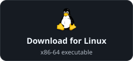

<p align="center"></p>
<p align="center"><b>Daedalus</b> is a terminal workspace for shells and AI coding agents, with Telegram control and a local agent API.</p>
<p align="center">


<a href="LICENSE"></a>
</p>
<p align="center">
&nbsp;
&nbsp;
&nbsp;
&nbsp;
&nbsp;
&nbsp;
&nbsp;
&nbsp;
&nbsp;

</p>

<p align="center">
  <a href="https://github.com/0xyg3n/Daedalus/releases/download/v0.2.0-beta.40/daedalus-0.2.0-beta.40-x86_64-linux"></a>
  <a href="https://github.com/0xyg3n/Daedalus/releases/download/v0.2.0-beta.40/Daedalus-0.2.0-beta.40-setup.exe"></a>
</p>
<p align="center">
  SHA-256:
  <a href="https://github.com/0xyg3n/Daedalus/releases/download/v0.2.0-beta.40/daedalus-0.2.0-beta.40-x86_64-linux.sha256">Linux</a> ·
  <a href="https://github.com/0xyg3n/Daedalus/releases/download/v0.2.0-beta.40/Daedalus-0.2.0-beta.40-setup.exe.sha256">Windows</a>
</p>

[Release notes and all downloads](https://github.com/0xyg3n/Daedalus/releases).


[Watch the 30-second video](assets/screenshots/demo.mp4). The demo uses sample data;
music and transition effects are part of the recording.

## Why use it

- **Keep a project together.** Group shells, coding agents and logs in workspaces;
  find terminals with search, pins and recent destinations.
- **Keep processes running.** Start a persistent terminal, detach and return from
  another Daedalus window. Built-in terminals need no separate multiplexer.
- **Choose how to work.** Browse a tree, compare terminal previews or attach and
  type in place. Tree, Tiles, Wall, Cube and Focus share the same inventory.
- **Continue a conversation.** Save checkpoints, resume or fork supported sessions,
  and pass reviewed context to another harness.
- **Work through Telegram.** Assign a DM or group to an agent conversation. Send
  text, photos and files; receive assistant replies and progress through hooks.
- **Automate the controls.** Local agents can inspect and manage terminals,
  checkpoints, routes, hooks and goals through a versioned JSON CLI.

One Rust executable provides the TUI, CLI, Telegram service and hooks. Agents keep
their own accounts and runtimes. Optional Armonia integration supplies agent
numbers and aliases; Hindsight supplies scoped memory.

## Install

**Windows:** click **Download for Windows** above and open the downloaded
setup file. It installs Daedalus and creates a Start Menu shortcut.

**Linux:** click **Download for Linux**, verify the matching SHA-256 checksum,
then launch setup:

```sh
chmod +x daedalus-0.2.0-beta.40-x86_64-linux
./daedalus-0.2.0-beta.40-x86_64-linux setup
```

To install from source on Linux:

```bash
git clone https://github.com/0xyg3n/Daedalus.git
bash Daedalus/install.sh --source "$PWD/Daedalus"
~/.local/bin/daedalus setup
```

The installer detects architecture and reviews missing build dependencies. Setup
finds installed harnesses and lets you choose optional components. Native terminals
are the default; tmux and Herdr are optional. See the [installation guide](docs/INSTALL.md)
for checksums, Windows setup, configuration import, updates and removal.

Daedalus supports Linux and Windows and is in active development. Release packages
target x86-64. See [harness and platform support](docs/HARNESSES.md) for the
features available on each platform.

## Built-in terminals

```sh
daedalus shell --workspace my-project --name dev
daedalus shell --workspace my-project --name agent -- claude
```

Run any installed shell or harness using its normal arguments. Native terminals
use Linux PTYs or Windows ConPTY and are discoverable across launch directories.
Existing [tmux](https://github.com/tmux/tmux) and [Herdr](https://herdr.dev/) sessions
can also be managed, including Herdr sessions inside tmux.

**Ctrl+] then D** detaches while leaving the process running. One view controls
input and size; additional views can watch. Sessions survive closing the UI, not
a machine restart. Already-open external shells appear as read-only observations;
arbitrary shells cannot be adopted into a new PTY.

## Layouts

| Layout | Purpose |
| --- | --- |
| Tree | Browse backends, workspaces, tabs and panes in their hierarchy. |
| Tiles | Work within one workspace, with a large selected terminal and companion previews. |
| Wall | Scan activity across workspaces and inspect a selected terminal. |
| Cube | Rotate terminals within a workspace, resize the front face and attach in place. |
| Focus | Keep a terminal and its native split layout beside the workspace tree. |

| Tree | Tiles |
| --- | --- |
| <a href="assets/screenshots/tui.png"></a> | <a href="assets/screenshots/tiles.png"></a> |

| Cube | Wall |
| --- | --- |
| <a href="assets/screenshots/cube.png"></a> | <a href="assets/screenshots/wall.png"></a> |

**F1** searches shortcuts. **Ctrl+K** switches terminals. **Ctrl+P** finds commands.
Use **[ / ]** to switch layouts and **a** to attach. In Cube, click a face to attach
or outside the faces to detach. Full controls are in the [TUI guide](docs/TUI.md).

## Harness support

Native hook adapters cover **Claude Code, Codex, Grok, Hermes, Cursor, Pi and
OpenCode**. AGY (`agy`) and other terminal applications can run as ordinary terminals.
Hooks, session operations and goals depend on the harness, version and platform;
see the [compatibility matrix](docs/HARNESSES.md).

Setup and sign-in use each harness's own authentication flow. Hook installation
reviews changes to its native profile; some harnesses require their own trust
review or restart. See [hooks](docs/HOOKS.md) and [goal continuation](docs/GOALS.md).

## Telegram

Open **Options → Configuration settings → Telegram configuration**. Connect your
bot and owner ID, register a DM or group, assign its destination pane, install the
reply hooks and start the connection. Each chat has its own route.

Telegram runs as a separate process of the same binary and can remain active after
the TUI closes. Delivery follows the selected conversation and its hook-reported
state. See the [Telegram guide](docs/TELEGRAM.md)
for setup, service controls, supported messages and troubleshooting.

## Agent interface

```sh
daedalus agent capabilities
daedalus agent call < request.json
```

A request uses the same operations and target checks as the TUI:

```json
{"tool":"inventory","args":["--config-dir","/absolute/private/instance","--json"]}
```

The interface is a local JSON CLI, not an MCP server. See [agent tools](docs/AGENT_TOOLS.md)
for request formats, permissions and operation coverage.

## Documentation

| Guide | Contents |
| --- | --- |
| [Install](docs/INSTALL.md) | Installation, setup, private configuration, import and updates |
| [TUI](docs/TUI.md) | Workspaces, layouts, attachment and keyboard shortcuts |
| [Telegram](docs/TELEGRAM.md) | Bots, DMs, groups, routing, service controls and delivery |
| [Commands](docs/COMMANDS.md) | Complete CLI and Telegram command reference |
| [Harnesses](docs/HARNESSES.md) | Supported tools, versions and platform limits |
| [Hooks](docs/HOOKS.md) · [Goals](docs/GOALS.md) | Lifecycle integration, memory and continuation |
| [Agent tools](docs/AGENT_TOOLS.md) | Local automation and agent integration |
| [Architecture](docs/ARCHITECTURE.md) · [Security](SECURITY.md) | Code structure, testing and trust boundaries |

For development, run `./scripts/check.sh`. Coding agents should read [AGENTS.md](AGENTS.md).

Licensed under [Apache-2.0](LICENSE). Tool names and icons belong to their owners;
see [NOTICE](NOTICE). Special thanks to [Xtacy856X](https://github.com/Xtacy856X)
for Windows testing, debugging and feedback.
