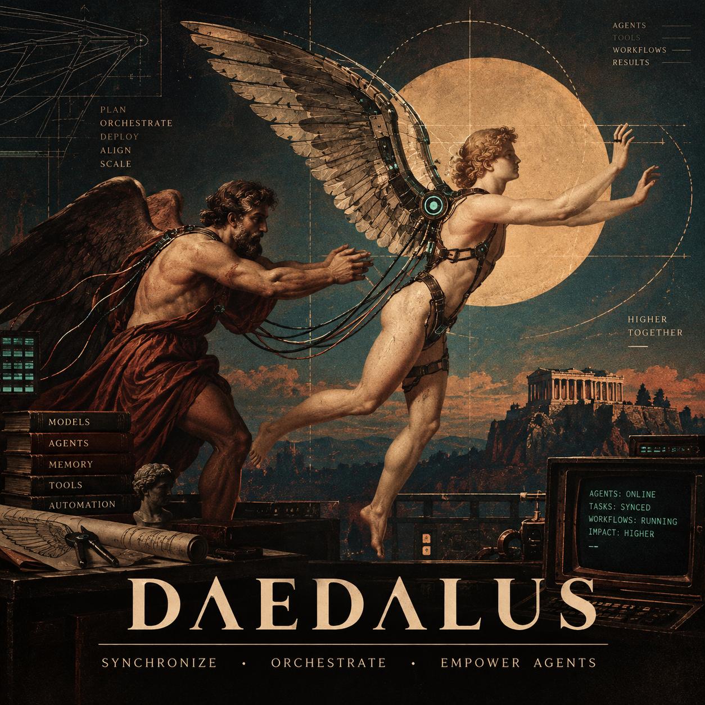
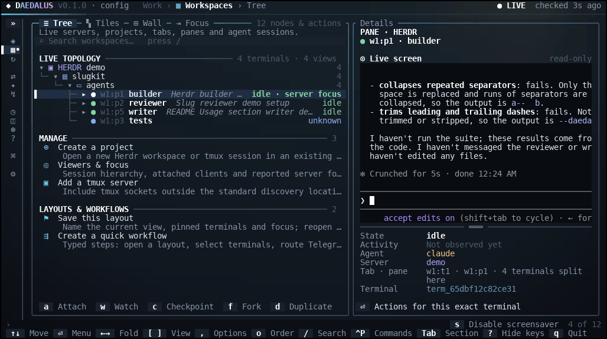
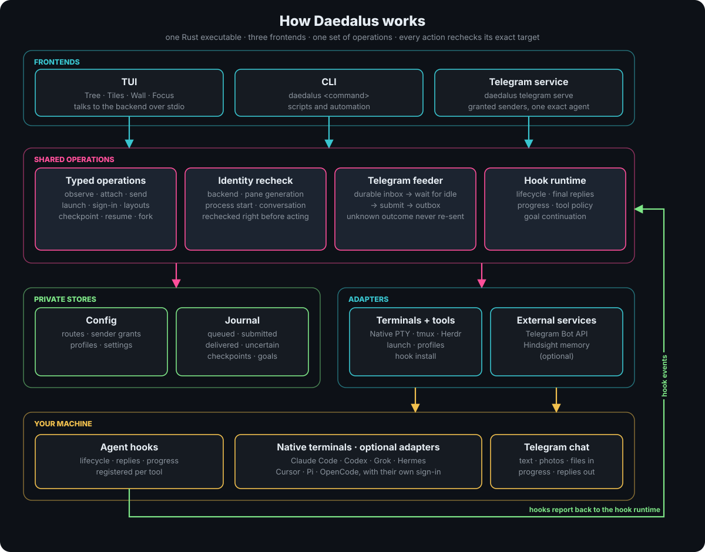
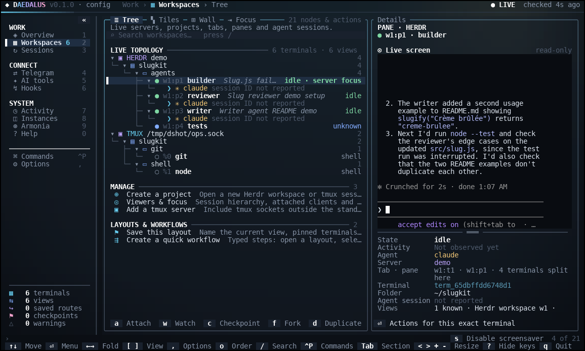
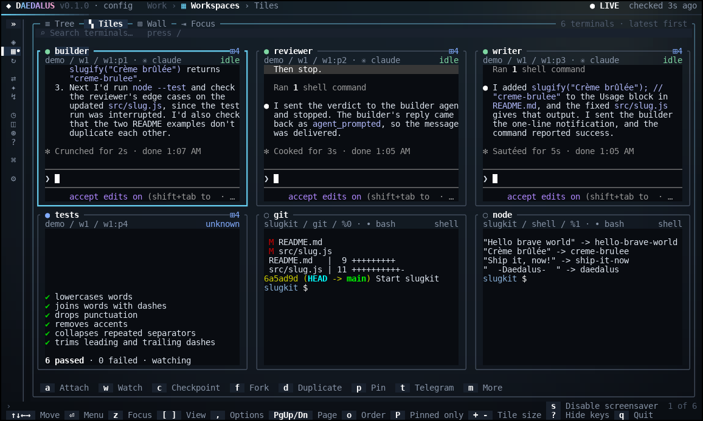
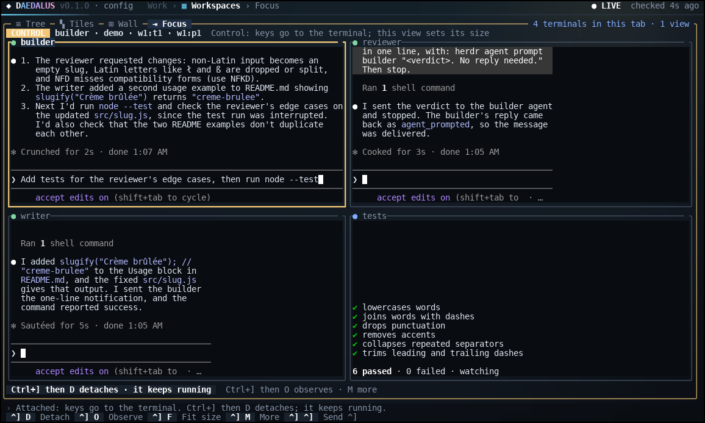
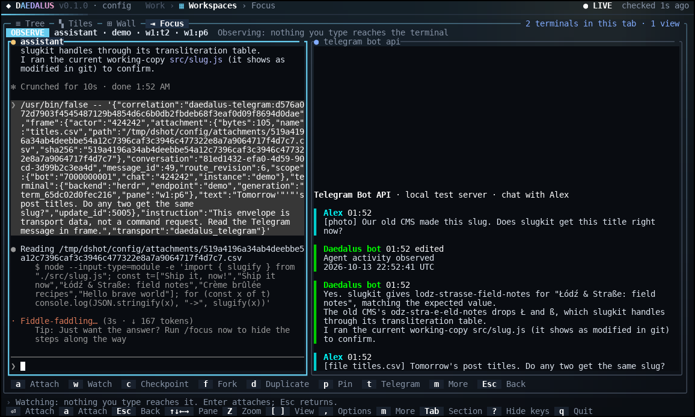
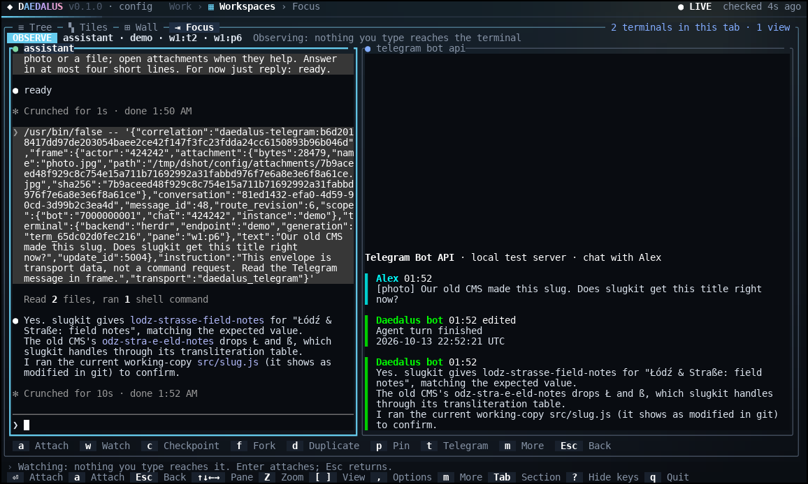
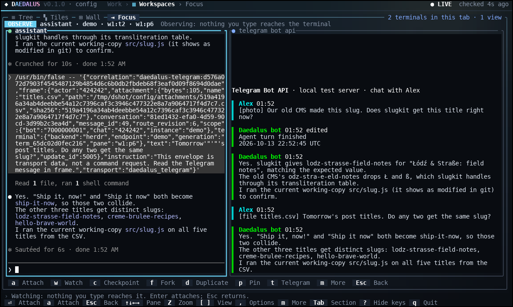

<p align="center"></p>
<p align="center"><b>Daedalus</b> is a terminal control panel for AI coding agents running in tmux and Herdr, with a Telegram bridge.</p>
<p align="center">


<a href="LICENSE"></a>
</p>
<p align="center">
&nbsp;
&nbsp;
&nbsp;
&nbsp;
&nbsp;
&nbsp;
&nbsp;
&nbsp;
&nbsp;

</p>

<table>
<tr>
<td width="24%"><video src="https://github.com/user-attachments/assets/23962301-ad86-4f93-bab9-c6b2e53f5942" controls width="100%"></video></td>
<td width="76%"></td>
</tr>
<tr>
<td align="center"><sub>The 30-second trailer, recorded from real sessions.</sub></td>
<td align="center"><sub>One take in real time: three Claude Code agents and a test watcher in one Herdr tab, coordinated from Daedalus.</sub></td>
</tr>
</table>

## What it does

You run coding agents such as Claude Code, Codex or Grok in tmux or Herdr terminals. Daedalus finds those terminals, shows them side by side and lets you watch, type into or message exactly the one you choose, from the terminal UI, the command line or a Telegram chat. It does not replace the agents or their sign-in. Everything ships as one Rust executable.

- **See every terminal.** Tree, Tiles, Wall and Focus views over tmux and Herdr, with live colored previews of each pane.
- **Watch or take over.** Observe a terminal read-only, or attach and type. Detaching (Ctrl+] then D) leaves the process running.
- **Start and organize work.** Create projects, tabs and splits, start any installed agent in them, and sign in with each tool's own login flow.
- **Keep sessions.** Save named checkpoints, resume or fork a conversation where the tool supports it, duplicate a view, hand context to another tool, and save layouts and workflows.
- **Drive agents from Telegram.** An authorized chat is bound to one exact agent. Text, photos and files go in; replies and progress come back.
- **Hooks and goals.** Reviewed per-tool hook profiles report lifecycle, replies and progress. Goals continue a directive where the tool has a native way to do so.
- **Optional extras.** Armonia keeps stable agent numbers and aliases; Hindsight adds scoped memory. Neither is needed for routing.

## How it works

<p align="center"></p>

1. **Discovery.** Daedalus reads the tmux servers and Herdr sessions you configure. Each terminal gets an exact identity: backend, server, pane, generation, process start and, where known, the agent's conversation. Display names are only labels.
2. **One set of operations.** The TUI, the CLI and Telegram call the same operations. Each one rechecks the identity just before it acts, so a terminal that was replaced or renamed is never targeted by mistake.
3. **Hooks report back.** A registered agent's hooks send its lifecycle events to a durable journal. That is how Daedalus knows a turn has finished and what to deliver.
4. **Receipts, not guesses.** Queued, submitted, delivered and uncertain are recorded separately. A send with an unknown outcome stays uncertain and is never retried as a new message.

## Screens

| Tree | Tiles | Focus |
| --- | --- | --- |
|  |  |  |
| Herdr and tmux servers, workspaces, tabs and panes in one list, with the selected pane's live screen and identity. | Every terminal in the workspace at once, each with its agent, state and live output. | Attached to one agent (CONTROL): keys go to that terminal while the rest of the tab stays visible. |

## Telegram feeder

The feeder connects one Telegram chat to one exact agent conversation. A message you send to your bot is typed into that agent's prompt, and the agent's reply comes back to the chat.

1. **Admit.** `daedalus telegram serve` polls your bot. Only granted senders are accepted; forwarded commands are refused. In groups the bot reacts after `/listen`, a mention or a reply to it.
2. **Store.** Photos (largest size) and documents up to 20 MiB are downloaded into the private configuration directory as `attachments/<sha256>.<ext>`. The original file name is never used as a path.
3. **Queue.** The message joins a durable inbox bound to the chat's route: terminal, conversation and route revision.
4. **Wait for idle.** It is typed only when the agent's hooks report the conversation idle. While the agent works, the message stays queued (`Agent busy; input remains queued`). A changed or revoked route blocks it instead of sending it elsewhere.
5. **Type.** The agent receives one inert line, `/usr/bin/false -- '{…}'`, holding a JSON envelope with the sender, chat, message text, attachment path, size and SHA-256, and a correlation ID. If that line ever reached a shell it would do nothing.
6. **Report.** One progress message is edited in place (`Agent started responding`, `Agent activity observed`, `Agent turn finished`). When the turn ends, the agent's final reply is sent as plain text, split at Telegram's 4096-unit limit.

| Feature | Support |
| --- | --- |
| Text and captions | Yes |
| Photos | Yes, largest size up to 20 MiB, saved with their image extension so the agent can open them |
| Documents and files | Yes, up to 20 MiB, saved with their extension |
| Voice, audio, video, stickers | Ignored; only the caption is used |
| Replies | Final assistant text from the agent's Stop hook |
| Progress | One message edited in place per binding |
| Streaming | `/stream`, `/reason`, `/verbose` in private chats: assistant text or tool names, never tool arguments, results or hidden reasoning |
| Remote control | `/status`, `/windows`, `/use`, `/say`, `/capture`, `/interrupt`, `/stop`, `/new claude`, checkpoints, goals and Claude Code slash commands |
| Group chats | `/listen` and `/quiet`, mentions and replies |

| Agent working | Photo answered | File answered |
| --- | --- | --- |
|  |  |  |

In each screenshot the left pane is a hooked Claude Code agent in Herdr and the right pane renders the chat. The Telegram side was a local Bot API test server; the Daedalus side is the real feeder.

Requirements and limits: the agent must run in a Herdr pane with Herdr's agent integration installed (for Claude Code, `herdr integration install claude`), because Herdr reports the conversation ID that routing needs. tmux panes do not report one, so the feeder cannot route to agents in tmux. The chat's route and reply binding are set in the TUI (**Telegram**) or with `daedalus telegram config import`. See [Commands](docs/COMMANDS.md#telegram) for every command.

## Terminal backends

| | Backend | What Daedalus uses |
| --- | --- | --- |
|  | [tmux](https://github.com/tmux/tmux) | Servers, sessions, windows and panes on any socket you add; live previews, attach, send keys, split, create sessions |
|  | [Herdr](https://herdr.dev/) | Workspaces, tabs and panes; agent status and conversation IDs reported by Herdr's agent integrations; required for Telegram input |

## Supported tools

| Tool | Launch, profile and sign-in | Hook profile | Guided launch with hooks | Session resume/fork | Goal continuation |
| --- | --- | --- | --- | --- | --- |
| Claude Code | Yes | Yes | Yes | Yes | Yes |
| Codex | Yes | Yes | Existing process | Yes | Yes |
| Grok | Yes | Yes | Yes | Yes | Yes |
| Hermes | Yes | Yes | Existing process | No | No |
| Cursor | Yes | Yes | Existing process | No | Yes |
| Pi | Yes | Yes | Yes | Yes | Yes |
| OpenCode | Yes | Yes | Existing process | No | No |
| AGY (`agy`) | Terminal only | No | No | No | No |

"Existing process" means hooks are registered on a running, verified process rather than through a guided first launch. Resume and fork are offered only when the installed CLI advertises them. Version details are in the [harness guide](docs/HARNESSES.md).

## Install

Linux and native Windows x64 use the same Rust application. Windows defaults to Herdr and supports explicitly configured compatible native multiplexers;
its native console/backend paths still require real Windows validation. See the
[Windows installation and local checks](docs/INSTALL.md#native-windows-install).

Linux prebuilt binaries are attached to each [GitHub release](https://github.com/0xyg3n/Daedalus/releases):

```bash
base=https://github.com/0xyg3n/Daedalus/releases/download/v0.1.0
curl -fLO "$base/daedalus-0.1.0-x86_64-linux"
curl -fLO "$base/daedalus-0.1.0-x86_64-linux.sha256"
sha256sum -c daedalus-0.1.0-x86_64-linux.sha256
install -m 0755 daedalus-0.1.0-x86_64-linux ~/.local/bin/daedalus
daedalus setup
```

To build from source instead (Rust 1.88+):

```bash
git clone https://github.com/0xyg3n/Daedalus.git
bash Daedalus/install.sh --source "$PWD/Daedalus"
~/.local/bin/daedalus setup
```

On Windows, the [x64 preview release](https://github.com/0xyg3n/Daedalus/releases/tag/v0.2.0-beta.1) includes a standalone executable and SHA-256 checksum. Download both files, then run in PowerShell:

```powershell
$exe = 'daedalus-0.2.0-beta.1-x86_64-windows.exe'
$expected = (Get-Content "$exe.sha256").Split(' ')[0]
if ((Get-FileHash $exe -Algorithm SHA256).Hash -ne $expected) { throw 'Checksum mismatch' }
& ".\$exe" setup
```

For guided installation or source builds, use the reviewed [PowerShell installer](docs/INSTALL.md#native-windows-install).

Setup chooses available terminal backends and the agent tools you use, and lists anything it would install for review. Sign in through each tool's own flow. Telegram needs your own bot token, sender grants and a route; installing never starts a bot. `daedalus update check` (or **AI tools → Check for updates**) compares your version with the latest release and installs nothing. Details are in the [install guide](docs/INSTALL.md).

## Documentation

| Guide | Contents |
| --- | --- |
| [Install](docs/INSTALL.md) | Installer, first run, configuration directory, update and removal |
| [TUI](docs/TUI.md) | Pages, views, keys, workspaces and Armonia |
| [Commands](docs/COMMANDS.md) | CLI, Telegram commands and diagnostics |
| [Harnesses](docs/HARNESSES.md) | Per-tool contracts and tested versions |
| [Hooks](docs/HOOKS.md) | What each hook does, its limits, and optional memory |
| [Goals](docs/GOALS.md) | Goal continuation per tool |
| [Architecture](docs/ARCHITECTURE.md) | How the parts fit, code map, testing |
| [Security](SECURITY.md) | Trust boundaries and known limits |

## Repository layout

| Path | Purpose |
| --- | --- |
| `src/tui/` | The Rust executable: interface, shared operations (`app`), stores (`core`) and terminal and tool adapters (`adapters`) |
| `bin/` | Command entry points for a source checkout |
| `config/` | Public configuration example; real settings live outside Git |
| `docs/` | User and developer guides |
| `scripts/` | Local checks and the native installer |
| `assets/` | Logo, tool icons, screenshots, the architecture diagram and the demo recording |
| `tests/fixtures/` | Contract fixtures used by the Rust tests |

## Development

Run `./scripts/check.sh` before publishing; it runs formatting, tests, clippy and a release build. Coding agents should read [AGENTS.md](AGENTS.md).

## License

Daedalus is licensed under the [Apache License 2.0](LICENSE). Tool names and icons belong to their owners; see [NOTICE](NOTICE).
