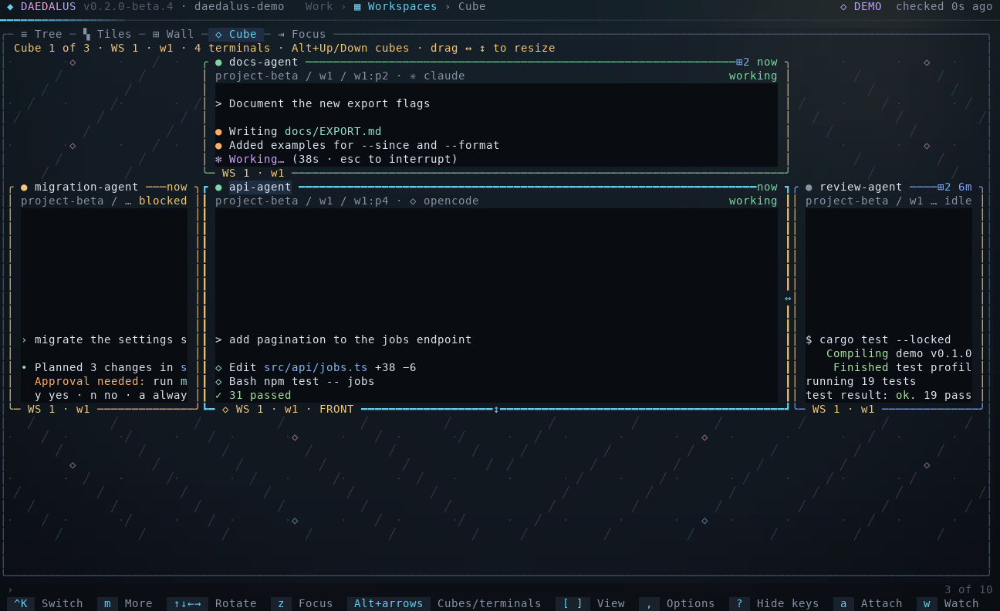
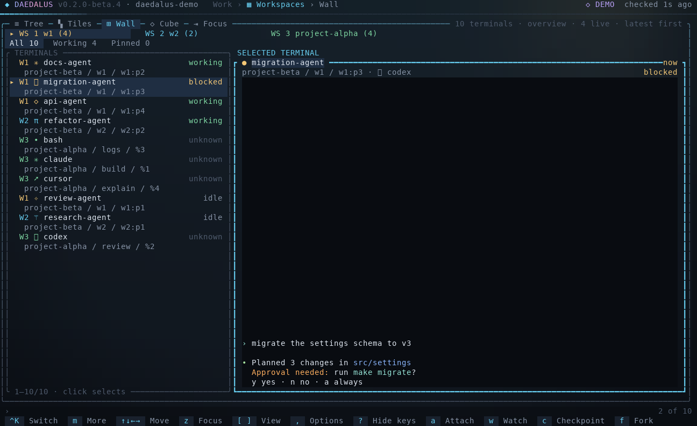

<p align="center"></p>
<p align="center"><b>Daedalus</b> is a terminal control panel for AI coding agents running in tmux and Herdr, with a Telegram bridge.</p>
<p align="center">


<a href="LICENSE"></a>
</p>
<p align="center">
&nbsp;
&nbsp;
&nbsp;
&nbsp;
&nbsp;
&nbsp;
&nbsp;
&nbsp;
&nbsp;

</p>

<p align="center">

</p>

**See the layout controls in action:** [watch the 30-second video with music (MP4)](assets/screenshots/demo.mp4).
A faster cut of the native TUI, with an original electronic soundtrack and brief glitch transitions. The GIF is silent.
Recorded using built-in sample data; the music and transition effects are video editing, not terminal features.
The tour uses built-in sample workspaces and terminal output.


The current release is [0.2.0-beta.7](https://github.com/0xyg3n/Daedalus/releases/tag/v0.2.0-beta.7), with Linux and Windows x86-64 binaries and SHA-256 checksums. Daedalus ships as one Rust executable, including the TUI, CLI, Telegram service and hooks. See [architecture and supported operations](docs/ARCHITECTURE.md#supported-operations) for runtime details and feature boundaries.

## What it does

You run coding agents such as Claude Code, Codex or Grok in tmux or Herdr terminals. Daedalus finds those terminals, shows them side by side and lets you watch, type into or message exactly the one you choose, from the terminal UI, the command line or a Telegram chat. It does not replace the agents or their sign-in. Everything ships as one Rust executable.

- **Choose your layout.** Browse the hierarchy in Tree, work within a project in Tiles, scan the fleet in Wall, rotate and resize terminal faces in Cube, or use Focus with its workspace tree. [Compare the layouts below](#layouts).
- **Watch or take over.** Observe a terminal read-only, or attach and type. Detaching (Ctrl+] then D) leaves the process running. In Focus, drag split dividers or use Alt+arrows to resize the actual panes; while attached, press Ctrl+] first.
- **Start and organize work.** Create projects, tabs and splits, start any installed agent in them, and sign in with each tool's own login flow.
- **Keep sessions.** Save named checkpoints or context-only excerpts from a terminal, resume or fork a conversation where the tool supports it, duplicate a view, hand context to another tool, and save layouts and workflows.
- **Drive agents from Telegram.** An authorized chat is bound to one exact agent. Text, photos and files go in; replies and progress come back.
- **Hooks and goals.** Reviewed per-tool hook profiles report lifecycle, replies and progress. Goals continue a directive where the tool has a native way to do so.
- **Optional extras.** Armonia keeps stable agent numbers and aliases; Hindsight adds scoped memory. Neither is needed for routing.

**Ctrl+K** opens a searchable terminal
switcher with pinned and recent destinations; **Alt+1–9** opens a visible result.
Herdr selection time and visit counts are private local aggregates, not token or
billing measurements. See [quick switching and usage](docs/TUI.md#quick-terminal-switcher-and-herdr-usage).

## How it works

<p align="center"></p>

1. **Discovery.** Daedalus reads the tmux servers and Herdr sessions you configure. Each terminal gets an exact identity: backend, server, pane, generation, process start and, where known, the agent's conversation. Display names are only labels.
2. **One set of operations.** The TUI, the CLI and Telegram call the same operations. Each one rechecks the identity just before it acts, so a terminal that was replaced or renamed is never targeted by mistake.
3. **Hooks report back.** A registered agent's hooks send its lifecycle events to a durable journal. That is how Daedalus knows a turn has finished and what to deliver.
4. **Receipts, not guesses.** Queued, submitted, delivered and uncertain are recorded separately. A send with an unknown outcome stays uncertain and is never retried as a new message.

## Layouts

| Layout | Use it for | Controls |
| --- | --- | --- |
| [Tree](assets/screenshots/tui.png) | Browse servers, workspaces, tabs, panes and agent sessions in their hierarchy. | Arrows navigate and fold branches; `/` searches. |
| [Tiles](assets/screenshots/tiles.png) | Work within one workspace, with a large selected screen and a strip of companion terminals. | Arrows select; PageUp/PageDown pages; Alt+Up/Down changes workspace. |
| [Wall](assets/screenshots/wall.png) | Scan terminal activity across the fleet, then inspect one readable screen. | Click a row to select; All / Working / Pinned changes scope. |
| [Cube](assets/screenshots/cube.png) | Rotate terminals within a workspace and adjust the front face to your task. | Arrows rotate; Alt+Up/Down changes cube; Alt+Left/Right changes only the front terminal. |
| Focus | Work with a terminal and its native split tab while keeping the workspace tree visible. | `z` opens Focus; Esc returns; drag native split dividers to resize. |

Use **[ / ]** to change layouts while keeping the selected terminal. In Cube,
Tiles and Wall, **a** attaches in place; **Ctrl+] then D** detaches without stopping
the terminal. In Cube, drag **↔ / ↕** on the front face, or use **< / >** for width
and **+ / -** for height. While typing, press **Ctrl+]** before a resize key.
Proportions persist in your local layout.

| Cube: rotate and resize | Wall: fleet status and a selected screen |
| --- | --- |
|  |  |

These captures use built-in sample data. See the [TUI guide](docs/TUI.md)
for attachment, resizing, saved layouts and reduced-motion settings.

## Telegram feeder

The feeder connects one Telegram chat to one exact agent conversation. A message you send to your bot is typed into that agent's prompt, and the agent's reply comes back to the chat.

1. **Admit.** `daedalus telegram serve` polls your bot. Only granted senders are accepted; forwarded commands are refused. In groups input requires `/listen`, a mention or a reply to the bot.
2. **Store.** Photos (largest size) and documents up to 20 MiB are downloaded into the private configuration directory as `attachments/<sha256>.<ext>`. The original file name is never used as a path.
3. **Queue.** The message joins a durable inbox bound to the chat's route: terminal, conversation and route revision. A 👀 reaction confirms that it was saved, not that the agent has processed it.
4. **Wait for idle.** It is typed only when the agent's hooks report the conversation idle. While the agent works, the message stays queued (`Waiting for verified agent readiness; input remains queued`). A changed or revoked route blocks it instead of sending it elsewhere.
5. **Type.** The agent receives one inert line, `/usr/bin/false -- '{…}'`, holding a JSON envelope with the sender, chat, message text, attachment path, size and SHA-256, and a correlation ID. If that line ever reached a shell it would do nothing.
6. **Report.** One progress message is edited in place (`Agent started responding`, `Agent activity observed`, `Agent turn finished`). Verified assistant replies are sent as plain text, split at Telegram's 4096 UTF-16-unit limit. Typing refreshes while the registered conversation reports Busy; it is not a task-completion signal.

| Feature | Support |
| --- | --- |
| Text and captions | Yes |
| Photos | Yes, largest size up to 20 MiB, saved with their image extension so the agent can open them |
| Documents and files | Incoming only, up to 20 MiB, saved with their extension; outbound file/media delivery is not yet available |
| Voice, audio, video, stickers | Ignored; only the caption is used |
| Replies | Verified assistant text from provider hooks; plain text, with no rich Markdown rendering yet |
| Receipt and typing | 👀 after durable admission; typing while verified Busy. Cosmetic feedback is best effort and does not block delivery |
| Progress | One message edited in place per binding |
| Streaming | `/stream`, `/reason`, `/verbose` in private chats where supported: assistant text or tool names. Grok live streaming remains unavailable. No tool arguments, results or hidden reasoning |
| Command menu | Canonical commands are registered for Telegram autocomplete; command aliases use the same permissions and route checks |
| Remote control | `/status`, `/windows`, `/use`, `/say`, `/capture`, `/interrupt`, `/stop`, `/new claude`, checkpoints, goals and Claude Code slash commands |
| Group chats | `/listen` and `/quiet`, mentions and replies |

Requirements and limits: the agent must run in a Herdr pane with Herdr's agent integration installed (for Claude Code, `herdr integration install claude`), because Herdr reports the conversation ID that routing needs. tmux panes do not report one, so the feeder cannot route to agents in tmux. The chat's route and reply binding are set in the TUI (**Telegram**) or with `daedalus telegram config import`. See [Commands](docs/COMMANDS.md#telegram) for every command.

## Terminal backends

| | Backend | What Daedalus uses |
| --- | --- | --- |
|  | [tmux](https://github.com/tmux/tmux) | Servers, sessions, windows and panes on any socket you add; live previews, attach, send keys, split, create sessions |
|  | [Herdr](https://herdr.dev/) | Workspaces, tabs and panes; agent status and conversation IDs reported by Herdr's agent integrations; required for Telegram input |

## Supported tools

| Tool | Launch, profile and sign-in | Hook profile | Guided launch with hooks | Session resume/fork | Goal continuation |
| --- | --- | --- | --- | --- | --- |
| Claude Code | Yes | Yes | Yes | Yes | Yes |
| Codex | Yes | Yes | Existing process | Yes | Yes |
| Grok | Yes | Yes | Yes | Yes | Yes |
| Hermes | Yes | Yes | Existing process | No | No |
| Cursor | Yes | Yes | Existing process | No | Yes |
| Pi | Yes | Yes | Yes | Yes | Yes |
| OpenCode | Yes | Yes | Existing process | No | No |
| AGY (`agy`) | Terminal only | No | No | No | No |

The table above describes Linux support. Native Windows has a smaller [hook and harness compatibility matrix](docs/HARNESSES.md#native-windows-boundaries). "Existing process" means hooks are registered on a running, verified process rather than through a guided first launch. Resume and fork are offered only when the installed CLI advertises them. Version details are in the [harness guide](docs/HARNESSES.md).

## Use Daedalus from another agent

An agent with a local command tool can call the same Rust operations as the TUI. `daedalus agent capabilities` lists the available operations; `daedalus agent call` accepts one JSON request on stdin and returns a versioned JSON result.

```json
{"tool":"inventory","args":["--config-dir","/abs/instance","--json"]}
```

Pass that request to `daedalus agent call`. Terminal control, checkpoints, routes, hooks, goals, Telegram administration and diagnostics use their existing identity checks and preview/apply rules. No approval flags are added automatically. Interactive attachment, sign-in and setup stay in the native CLI or TUI. This is a local JSON CLI interface; it is not an MCP server. Requests can include a `request_id` for response correlation. `workspace_usage` reads private Herdr selection aggregates without capturing terminal text. See the [agent tools guide](docs/AGENT_TOOLS.md) for integration examples and current coverage.

## Platform support

| Platform | Status | Terminal backends | Installation |
| --- | --- | --- | --- |
| Linux x86-64 | Current beta; tested locally | tmux and Herdr | [Linux executable and checksum](https://github.com/0xyg3n/Daedalus/releases/tag/v0.2.0-beta.7) or source build below |
| Windows x86-64 | Native preview; real Windows validation pending | Herdr, [PSMux](https://github.com/psmux/psmux) or [tmux-windows](https://github.com/arndawg/tmux-windows) through the tmux adapter | [Windows executable and checksum](https://github.com/0xyg3n/Daedalus/releases/tag/v0.2.0-beta.7) or [PowerShell installer](docs/INSTALL.md#native-windows-install) |

Both platforms use the same standalone Rust executable and Ratatui interface. On Windows, use PowerShell in Windows Terminal and install a native backend separately. Set `DAEDALUS_TMUX_BIN` to the absolute path of `psmux.exe` or `tmux.exe` to select a particular multiplexer. Native provider launches require `.exe` files; `.cmd` and `.bat` wrappers are refused.

The Windows preview passes cross-compilation and Windows unit tests under Wine. Actual Windows Terminal/ConPTY, NTFS permissions and live backend/provider behavior still need validation on Windows. Hook support differs by platform, guided launch with hooks is unavailable on Windows, and Herdr duplicate attachment is unavailable there. See the [Windows boundaries](docs/HARNESSES.md#native-windows-boundaries) and [local Windows checks](docs/INSTALL.md#windows-local-validation). macOS and native Windows ARM64 are not currently validated or distributed.

## Install

The current Linux x86-64 beta includes a binary and checksum:

```bash
base=https://github.com/0xyg3n/Daedalus/releases/download/v0.2.0-beta.7
curl -fLO "$base/daedalus-0.2.0-beta.7-x86_64-linux"
curl -fLO "$base/daedalus-0.2.0-beta.7-x86_64-linux.sha256"
sha256sum -c daedalus-0.2.0-beta.7-x86_64-linux.sha256
mkdir -p ~/.local/bin
install -m 0755 daedalus-0.2.0-beta.7-x86_64-linux ~/.local/bin/daedalus
daedalus setup
```

To build from source instead (Rust 1.88+):

```bash
git clone https://github.com/0xyg3n/Daedalus.git
bash Daedalus/install.sh --source "$PWD/Daedalus"
~/.local/bin/daedalus setup
```

On Windows, the [x64 preview release](https://github.com/0xyg3n/Daedalus/releases/tag/v0.2.0-beta.7) includes a standalone executable and SHA-256 checksum. Download both files, then run in PowerShell:

```powershell
$exe = 'daedalus-0.2.0-beta.7-x86_64-windows.exe'
$expected = (Get-Content "$exe.sha256").Split(' ')[0]
if ((Get-FileHash $exe -Algorithm SHA256).Hash -ne $expected) { throw 'Checksum mismatch' }
& ".\$exe" setup
```

For guided installation or source builds, use the reviewed [PowerShell installer](docs/INSTALL.md#native-windows-install).

Setup chooses available terminal backends and the agent tools you use, and lists anything it would install for review. Sign in through each tool's own flow. Telegram needs your own bot token, sender grants and a route; installing never starts a bot.

The TUI checks releases in the background at launch and before exit, and offers an update when one is available (**Later** at launch; **Exit** when closing). There are no periodic checks. **Options → Application → Check for updates** checks on demand (**Ctrl+U**); inside an attached terminal use **Ctrl+]**, then **U**. Beta installations include newer betas; stable installations select stable releases. Installation requires your approval and verifies checksums and architecture. Linux activates the verified binary while retaining the previous one; Windows stages it for manual activation after closing the application. Install completion opens a confirmation when the interface is free and keeps a status notice visible until restart. `DAEDALUS_UPDATE_CHECK=0` disables automatic checks; manual checks remain available. `daedalus update check --json` only checks. Details are in the [install guide](docs/INSTALL.md).

## Documentation

| Guide | Contents |
| --- | --- |
| [Install](docs/INSTALL.md) | Installer, first run, configuration directory, update and removal |
| [TUI](docs/TUI.md) | Pages, views, keys, workspaces and Armonia |
| [Agent tools](docs/AGENT_TOOLS.md) | JSON requests for harness command tools; capabilities, reviews and limitations |
| [Commands](docs/COMMANDS.md) | CLI, Telegram commands and diagnostics |
| [Harnesses](docs/HARNESSES.md) | Per-tool contracts and tested versions |
| [Hooks](docs/HOOKS.md) | What each hook does, its limits, and optional memory |
| [Goals](docs/GOALS.md) | Goal continuation per tool |
| [Architecture](docs/ARCHITECTURE.md) | How the parts fit, code map, testing |
| [Security](SECURITY.md) | Trust boundaries and known limits |

## Repository layout

| Path | Purpose |
| --- | --- |
| `src/tui/` | The Rust executable: interface, shared operations (`app`), stores (`core`) and terminal and tool adapters (`adapters`) |
| `bin/` | Command entry points for a source checkout |
| `config/` | Public configuration example; real settings live outside Git |
| `docs/` | User and developer guides |
| `scripts/` | Local checks and the native installer |
| `assets/` | Logo, tool icons, screenshots, the architecture diagram and the demo recording |
| `tests/fixtures/` | Contract fixtures used by the Rust tests |

## Development

Run `./scripts/check.sh` before publishing; it runs formatting, tests, clippy and a release build. Coding agents should read [AGENTS.md](AGENTS.md).

## License

Daedalus is licensed under the [Apache License 2.0](LICENSE). Tool names and icons belong to their owners; see [NOTICE](NOTICE).
