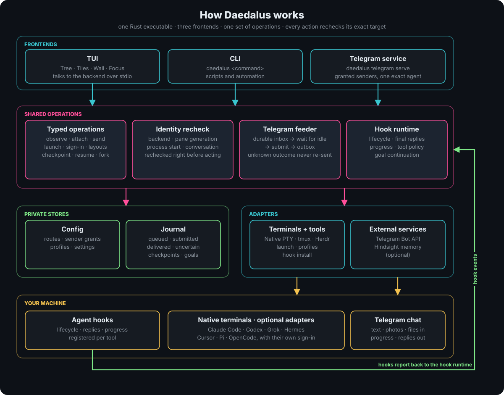

# Architecture

<p align="center"></p>

Daedalus is one Rust executable built from `src/tui`. It contains the Ratatui
interface, the CLI and its backend, the Telegram service and the hook runtime.
Shared operations live in `src/tui/src/app`, durable stores in `core`, and terminal
and tool boundaries in `adapters`.

## Interface and backend

The interface starts the same executable as `daedalus backend --stdio` and talks to
it over a local, versioned JSON protocol (version 2). Requests carry state queries,
previews, exact-target operations and dialog answers; each confirmation can be used
once. The protocol is not a network API.

`view.rs` composes navigation and lists. Modules in `view/` own the overview,
selected-record details, dialogs and terminal layouts. `ui_text.rs` supplies
shared grapheme-aware fitting, wrapping and input display. Wrapped dialog text is
cached until its source or width changes. `ui_scroll.rs` shares viewport bounds
and scroll indicators across lists and overlays; source positions use `usize`
independently of terminal dimensions. Inventory projections index parent links
and stop at cycles. Form editing and
independent inspector scrolling live in the UI model; rendering does not perform
backend operations. Selecting a modal choice is separate from confirming it.

## Native terminal backend

`app/native_terminal.rs` owns a detached PTY/ConPTY daemon for each native
terminal. `adapters/native.rs` projects its observations and launches into the
shared terminal operations. Detaching a client leaves the shell alive; closing
the terminal ends the owned process. User-wide discovery uses an owner-private
registry, independent of the UI's working directory or configuration instance.

Clients authenticate a fresh server challenge before sending input over loopback.
Requests and replies are authenticated and bound to the terminal generation;
captured requests cannot be replayed on a new connection. One renewable control
lease owns input and resize. Observers receive rendered screens but cannot mutate
terminal size or write. A lost write acknowledgement remains uncertain.

Native scrollback capacity is a saved launch policy. A stream or explicit capture
can request a history offset without acquiring input authority. The parser lock
protects the temporary projection and restores its shared live position before
release. Each stream keeps its own clamped offset; controller input returns only
that stream to live. An older daemon lacking offset metadata produces an explicit
unavailable notice without replacing or terminating its live session.

The backend parses ANSI output into a bounded screen; it does not forward raw
terminal escape sequences to viewers. External process discovery is a separate,
read-only adapter in `adapters/standalone.rs`. It cannot adopt an arbitrary existing
shell's PTY, read all Windows application tabs, or control another user's processes.

`app/discovery_budget.rs` shares a monotonic deadline and atomic JSON byte/value
admission budget across native, socket, endpoint and external discovery. Wire
preflight counts nested values and object keys before materializing replies;
normalized representations are charged again. Owned queries use remaining time,
native RPCs have absolute exchange deadlines, and late cooperative scan results
are refused. Earlier verified rows survive incompleteness. These limits bound
cumulative discovery metadata, with separate in-flight buffers and presentation
limits; they do not measure total process memory. Tree view grouping uses the
full backend/endpoint/pane/generation identity and shares repeated view metadata.
`app/tree_relations.rs` builds borrowed client, topology, viewer, checkpoint and
exact native-route indexes. Compact client counts avoid per-terminal label-list
expansion. Saved optional relationship count/JSON-byte/cooperative time limits
cover view-place details and nested/declared/checkpoint/route nodes while retaining
base terminals. Partial indexes never claim input is unused. Legacy display-label
route inference is retired. Grouping and linked badges preserve full identity.
`adapters/pane_observations.rs` indexes full terminal identity and view location.
Identical same-view rows collapse; contradictory rows mark every captured view of
that physical identity. Marked rows retain known identity and location while
discarding process, conversation and geometry hints. Native inventory and tree
consumers share normalization. Adapter verification, preview/selection admission
and layout projection refuse marked terminals. Observation warnings preserve
partial/stale status, and a later clean snapshot restores normal projection.
View preferences and graceful quit do not require a verified terminal selection.

State frame projection admits exact rows before retaining them, preserves their
parent-before-child prefix and keeps compiled settings controls accessible when
the display is limited. The text hierarchy has a separate bounded outline path.

`app/tree_layout.rs` projects complete layout groups from exact base pane nodes.
It preserves linked tmux views independently, refuses ambiguous Herdr matches and
preflights serialized geometry against saved pane, byte and cooperative time
limits. Invalid or omitted geometry reports incompleteness without losing base
terminals or overriding a stale refresh. `core/geometry.rs` shares checked 16-bit
coordinates, non-overlap validation and indexed border adjacency between this
projection, divider rendering and resize admission. Parent labels are evaluated
only when a parent is first added. The backend sends a typed saved resize policy
to the interface and independently checks the latest policy, geometry and exact
terminal identities before submitting a resize once. Geometry and border indexes
avoid repeated pane-pair scans; these limits do not bound all base topology work.

`app/herdr_resize.rs` validates the complete native binary split topology against
the captured pane rectangles, using an iterative traversal bounded by the saved
resize pane limit. It resolves the native directional border, calculates its
ratio from the ancestor area and predicts rounded geometry for every descendant.
Requests subject to native ratio clamping or saved minimum-size violations are
refused. The effect path revalidates every changed terminal before one submission
and checks correlated target, scope and full returned pane geometry before
confirming it. Missing or contradictory acknowledgements stay unconfirmed without
replay. Private installed Herdr 0.9.0 Linux server tests cover nested moves in both
axes and directions, focus preservation, zoom refusal and non-neighbor minimums;
they do not establish all Herdr versions or native Windows compatibility.

`app/view_records.rs` decodes structured viewer/source identities and refuses
ambiguous legacy delimiters, conflicting associations and partial uniqueness
passes. Live viewers use an identity index; duplicate linked observations count
once. Reads preserve historical records, and saved retention applies only after a
confirmed new registration. `app/view_history.rs` preflights the private JSON
before allocating parsed records, refuses duplicate keys and applies saved file
bytes, cumulative value/key counts and a cooperative processing deadline. Raw,
projected and saved representations count again. Atomic writes are admitted only
after bounded serialization; reads and refused registrations preserve history.
Live projection retains known borrowed fields under the same remaining discovery
budget as native inventory, without cloning arbitrary saved payloads. Complete
identity passes are still required. Repeated budget finalization does not duplicate
its own warning records. These limits bound admitted metadata and processing
checkpoints, not total process RSS or blocking filesystem duration.

All saved-reference producers share
`adapters/terminals.rs::reference`. `core/layouts.rs` translates the historical
tmux/native display aliases without filesystem rebinding, preserves supplemental
generation fields and supplies complete pin-removal selectors. Layout resolution,
pin badges, workflow matching and checkpoint capture share those reference rules.
Checkpoint tree links retain native-ID candidate discovery while explicitly
disclosing saved profile/project/source and current-profile uncertainty. Exact
source reference equality identifies historical origin, not current account
access. Saved `ui.checkpoint_matches` selects all candidates, exact origins or no
tree links; all configured tree consumers carry that policy. Optional checkpoint
metadata is admitted before cloning. Saved checkpoint listing and explicit
saved-profile launch/review semantics are unchanged. Current occupant-role
lifecycle and provider/account access still require independent evidence.

`core/json_preflight.rs` supplies the shared duplicate-key/value walker used by
viewer history, import and checkpoint processing. `core/checkpoint_budget.rs`
bounds checkpoint registry/removal reads, normalization and encoded writes with
the saved file/work/entry/value/deadline policy. Exact source checkpoint JSON is
charged to import before normalization; optional checkpoint health values are
admitted to the remaining discovery budget before `Value` materialization.
Canonical and both legacy formats share one guard. Imports retain tombstones and
add translated keys for relocated context, preserving removal semantics. These
are logical admission/cooperative-time limits, not hard RSS or physical-I/O bounds.

## Identity and effects

A display name is never an identity. Every operation pins the backend, endpoint,
pane generation, process start and, where needed, the conversation, and rechecks
them just before acting. The TUI, CLI and Telegram all call the same operations.

Telegram keeps a durable inbox and outbox, with one lock per instance and bot.
Admitting input, submitting it to a terminal, observing it through hooks and
delivering a reply are separate states. Sender, route, registration and recipient
are rechecked at dispatch. An unknown outcome is kept for review and never re-sent.
A permission revoked after a request was sent cannot recall that request.

Private JSON and SQLite stores hold configuration, routes, checkpoints, goals,
layouts and receipts. Armonia and Hindsight are optional, each with its own
configuration; terminal routing needs neither. Agent tools keep their own
authentication and runtime. The Pi and OpenCode hook bridges run inside those tools.

Import publication verifies the captured manifest receipt and complete file hash
map again. Cutover verifies after its last live observation and before retirement
markers or directory renames. Its proof follows manifest sealing to avoid a
recursive hash, so the final check admits that one file only with the exact
reviewed proof bytes. Drift refuses publication and discards the owned stage.
One source-selected import budget covers payload admission, staged writes,
database copies and repeated snapshot validation/hashing through final admission.
Retained bytes/entries and cumulative JSON/byte work remain separate counters.
The former checkpoint-only fixed 64 MiB sum is replaced by the retained-byte
policy. Shared strict JSON preflight also serves viewer history. The deadline is
cooperative and includes review time after bounded settings bootstrap; it is not
a hard process-memory, transient-disk, total-I/O or elapsed-time guarantee. These
checks do not make multiple source stores one atomic snapshot.

Cutover iterates selected queued rows by ID without collecting owned payload
strings. Borrowed SQLite text is byte-bounded and strictly preflighted before
owned JSON/Frame construction. Verified source attachment basenames share the
producer's safe extension predicate. Per-reference quotas and the effective
service per-file limit remain separate; unrelated payload metadata survives the
path rewrite. Budget failures abort publication, while unsafe files become
blocked drafts. Unknown/in-flight evidence is not interpreted as retryable input.

On Windows, SQLite uses `TRUNCATE` journals with private sidecar files and in-memory
temporary storage. Existing WAL/SHM files must pass owner and ACL checks; data is
not deleted to bypass a journaling or permissions failure.

## Code map

| Area | Files | Notes |
| --- | --- | --- |
| Shared operations | `app/backend.rs`, CLI and menu modules | Unknown commands are rejected |
| Terminals | `adapters/terminals.rs`, `adapters/terminal_actions.rs`, `app/tree.rs` | Native PTY/ConPTY, tmux and Herdr; external process discovery is read-only |
| Agent tools | `adapters/harnesses.rs`, `app/hook_install.rs`, `app/hook_runtime.rs` | Launch, sign-in, profiles, hooks |
| Sessions | `app/session_actions.rs`, `app/session_menu.rs`, `app/session_cli.rs` | Resume, fork, handoff |
| Telegram | `app/telegram*.rs`, `adapters/telegram.rs` | Admission, outbox, commands, streams |
| Goals | `core/goal_store.rs`, `app/hook_runtime.rs` | Durable transitions and recovery |
| Setup and import | `app/wizard*.rs`, `app/setup.rs`, `app/config.rs`, `app/migration.rs`, `app/cutover.rs`, `app/dependencies.rs` | Dependencies reviewed before install |
| Gateway | `app/gateway.rs`, `app/gateway_config.rs`, `app/harness_menu.rs` | Reviewed Claude/Codex overrides, private backups, import/cutover credential consent |
| Dashboard | `app/instances.rs`, `app/dashboard.rs`, `app/dashboard_menu.rs` | Bounded global preferences, explicit roots/instances, frozen private settings reviews |
| Armonia | `app/agent_identity.rs`, `app/armonia_status.rs` | Reads an existing registry |
| Hindsight | `app/memory.rs`, `app/memory_menu.rs`, `app/memory_config.rs`, `app/memory_status.rs`, `adapters/hindsight.rs` | Reviewed settings and exact bank per registration |
| Diagnostics | `app/diagnostics.rs` | Aggregate status only |
| Interface | `src/tui/src/*.rs`, `src/tui/assets/commands.json` | Action catalog, navigation, tree fixtures |

Daedalus does not mirror raw console output, administer gateway accounts, run
unattended watchdogs or fail over between providers.

## Adding an integration

A new frontend or app connector goes through five stages: authorize the incoming
event, resolve an exact current route, dispatch through an existing typed
operation, correlate the tool's result, and record delivery evidence. Keep app,
sender, tool, account, terminal and conversation identities separate. Never derive
permissions from observed senders or use pane titles as identities. Recheck grants
and route revision before a queued delivery, and keep uncertain external effects
for review instead of retrying them.

## Testing

```bash
./scripts/check.sh
git diff --check
```

On native Windows, run `./scripts/check-windows.ps1` in PowerShell. It adds
isolated PE/checksum installer fixtures and performs the same Cargo checks.
The native Windows suite includes a real isolated ConPTY shell test for input,
capture, resize, identity refusal and cleanup. Installer fixtures verify individual
ownership and BOM-free receipts. Run these checks on Windows for native runtime
coverage. No hosted workflow is required.

`scripts/check.sh` runs `cargo fmt --check`, `cargo test --locked --all-targets`,
`cargo clippy -D warnings` and a release build for `src/tui`.

GitHub CI (`native-checks.yml`) runs these checks on Linux, Windows and macOS and
uploads each platform's release files with checksums. macOS uploads a universal
DMG and thin `daedalus-<version>-<arch>-macos` update executables. They are
ad-hoc signed unless a push to `main` has the `MACOS_CERTIFICATE_P12`,
`MACOS_CERTIFICATE_PASSWORD` and `MACOS_SIGNING_IDENTITY` secrets (Developer ID
Application); `MACOS_NOTARY_KEY` (App Store Connect API key, base64),
`MACOS_NOTARY_KEY_ID` and `MACOS_NOTARY_ISSUER` also notarize and staple the
DMG. Pull requests from forks never receive these secrets.
`./scripts/homebrew-cask.sh` prints a cask for the published universal DMG.

Tests use isolated state, synthetic hook events, local HTTP fixtures for Telegram
and Hindsight, and private tmux and shell fixtures. They never start a real bot,
send messages, touch user sessions or make paid model requests.
`src/tui/tests/ui_startup.rs` drives the interface in a PTY with no agent tools
installed; `src/tui/tests/native_cli.rs` runs the packaged CLI against private
state. `src/tui/tests/native_terminal.rs` exercises actual isolated native shell
processes, stream control, resize, stale identity refusal and detach survival.

Record the upstream harness version when reporting integration regressions. Run
a credential scan on the current tree before publishing.

## Supported operations

The TUI, CLI, Telegram service and local agent interface share the native
operations described in the [command reference](COMMANDS.md). See
[agent tools](HARNESSES.md) for provider and platform support,
[hooks](HOOKS.md) for lifecycle integration, [goals](GOALS.md) for continuation,
and [installation](INSTALL.md) for setup and configuration import.
