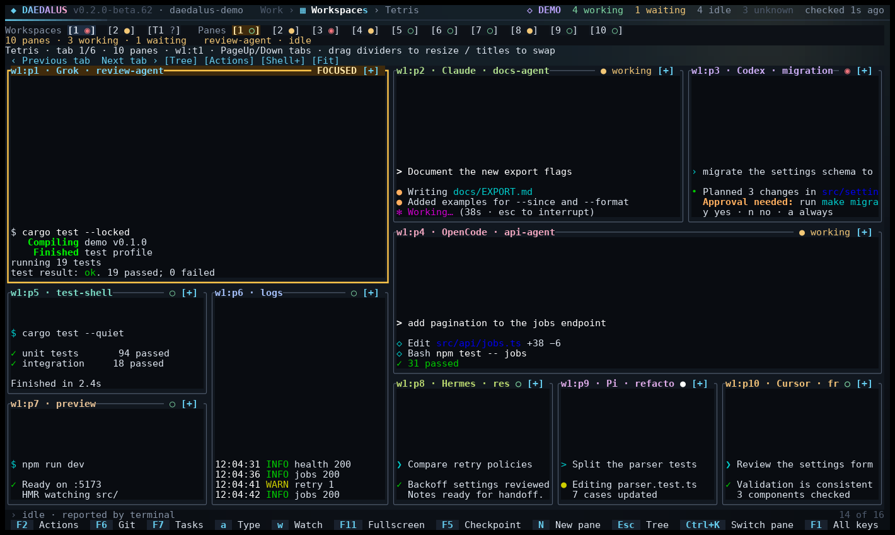
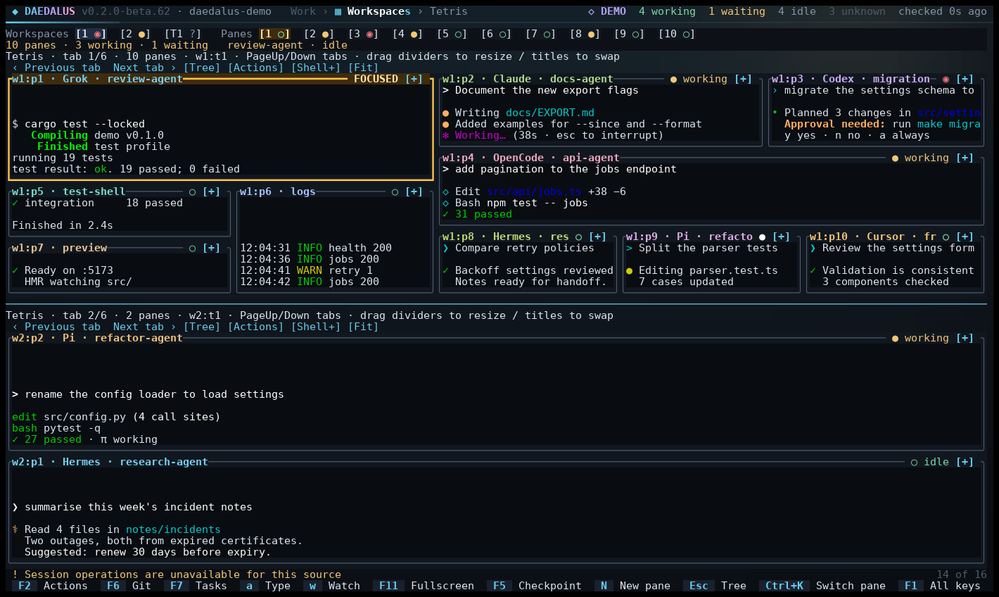

# Screenshot tour

These screens show Daedalus running in a separate terminal with sample data.
Run `daedalus tui --demo` to explore the same workspace and controls.

## Tetris

**F4** opens all panes from the selected tab. Herdr supplies the native split
layout. Daedalus adds colored pane titles, numbered activity, and editable
dividers. Drag a pane title to exchange positions in the Daedalus view.

Compare two workspaces side by side or stacked. Drag the divider between
them to give one workspace more space.

## Terminal views

| Screenshot | What it shows |
| --- | --- |
| [Tree](../assets/screenshots/beta62/tree.png) | Navigate servers, workspaces, tabs, panes and their agents. |
| [Tiles](../assets/screenshots/beta62/tiles.png) | Follow several panes with their status and recent output. |
| [Wall](../assets/screenshots/beta62/wall.png) | Browse a dense terminal list beside a preview of the selected pane. |
| [Cube](../assets/screenshots/beta62/cube.png) | Inspect adjacent pane previews around the selected terminal. |
| [Full-screen Focus](../assets/screenshots/beta62/focus.png) | Follow one terminal read-only. F11 restores Tetris. |

## Context menus, projects and recovery

| Screenshot | What it shows |
| --- | --- |
| [Pane context menu](../assets/screenshots/beta62/pane-actions.png) | F2 opens searchable actions with inline explanations on wide terminals. |
| [Pane control actions](../assets/screenshots/beta62/pane-actions-control.png) | Scroll through lower categories, including actions that require confirmation. |
| [Workspace context menu](../assets/screenshots/beta62/workspace-actions.png) | Right-click a workspace in Tree to show branch actions. |
| [New shell or workspace](../assets/screenshots/beta62/new-pane.png) | Choose a native terminal, tmux session or Herdr workspace. |
| [Save layout](../assets/screenshots/beta62/layouts.png) | Name the current arrangement so it can be restored later. |
| [Git review](../assets/screenshots/beta62/git-review.png) | F6 shows a project's changed paths and offers reviewed local Git actions. |
| [Agent orchestration](../assets/screenshots/beta62/orchestration.png) | F7 opens the plan builder with dependencies and parallel limits. |
| [Checkpoint dialog](../assets/screenshots/beta62/checkpoint.png) | Save a named checkpoint from the selected pane. |
| [Sessions](../assets/screenshots/beta62/sessions.png) | Find saved checkpoints for resume, fork or context handoff. |

See the [context menu reference](TUI.md#context-menu) for each action and the
[project guide](TUI.md#project-workflows) for Git and agent plans.

## Dashboard and configuration

| Screenshot | What it shows |
| --- | --- |
| [Overview](../assets/screenshots/beta62/overview.png) | View terminal counts, activity and setup shortcuts. |
| [Telegram](../assets/screenshots/beta62/telegram.png) | Configure a bot, connect a chat to an exact terminal and inspect delivery. |
| [Hooks](../assets/screenshots/beta62/hooks.png) | Review lifecycle hooks and manage harness profiles. |
| [Settings](../assets/screenshots/beta62/settings.png) | Open interface, runtime, memory, history and other settings. |
| [Appearance](../assets/screenshots/beta62/appearance.png) | Choose a color palette and configure layout and interface behavior. |
| [Activity](../assets/screenshots/beta62/activity.png) | Inspect action history, delivery receipts and discovery warnings. |
| [Instances](../assets/screenshots/beta62/instances.png) | Browse saved configuration sources and running instances. |
| [Remote workspace](../assets/screenshots/beta62/remote.png) | The SSH header identifies the remote instance. This capture uses a local SSH fixture. |
| [Hindsight settings](../assets/screenshots/beta62/memory.png) | Find the controls for optional memory and exact registration bindings. |
| [Armonia](../assets/screenshots/beta62/armonia.png) | See observed terminal identities in the optional integration. |
| [Command palette](../assets/screenshots/beta62/command-palette.png) | Search guided actions, Telegram commands and CLI entry points. |
| [Help](../assets/screenshots/beta62/help.png) | Open the everyday controls and complete command reference. |
