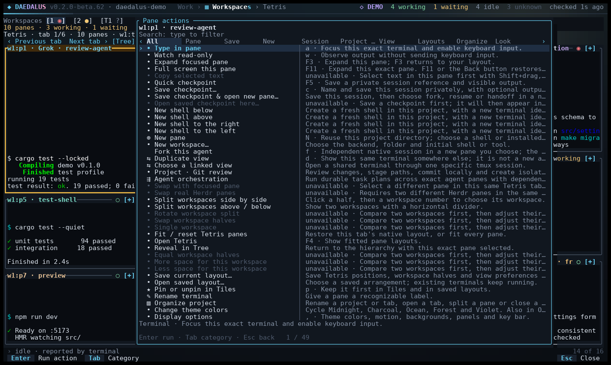
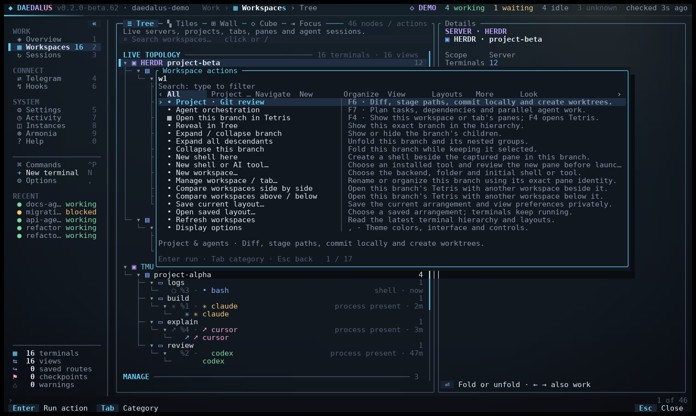

# Control panel

Run `daedalus` to open the panel. The first launch opens setup. The panel runs the
same executable as a local backend (`daedalus backend --stdio`) and never acts on a
terminal it cannot identify exactly.

## Pages

| Group | Pages |
|---|---|
| Work | Overview, Workspaces, Sessions |
| Connect | Telegram, Hooks |
| System | Settings, Activity, Instances, Armonia (optional), Help |

Tab follows these groups; Shift+Tab moves back. Number shortcuts keep the page
shown beside each name. Ctrl+P searches every command, `?` shows the key bar and
`q` quits. The Details panel explains the selected item. Help includes the
[command reference](COMMANDS.md).

Opening a new search or switching pages while an earlier action finishes keeps
your current page, query and selection. Its reply still updates observations and
reports the outcome. Enter explains when an action is still running; press it
again after completion to open a different action. A blocked Enter is not saved
for automatic execution.

- **Settings**: interface preferences, detected harnesses, profile directories,
  Telegram configuration, Hindsight settings, [control receipt history](HISTORY.md)
  and setup.
- **Hooks**: hook profiles and Hindsight memory ([hooks](HOOKS.md)).
- **Telegram**: guided connection settings, private bot token, service start and
  destination selection. Each step has its own review. Sender permissions are
  separate from routes; replies need an installed hook connected to the chat.
- **Activity**: what happened, and whether each step was attempted, queued,
  submitted, delivered or uncertain.
- **Instances**: saved configurations. One is shown as running only when its
  service is verified.

## First-time setup and Telegram

Choose **Daedalus native terminals** to use the built-in terminal backend without
installing tmux or Herdr. External backends remain optional. Setup shows the detected
operating system and architecture before presenting any dependency installation.
Setup detects installed harnesses and preselects them for review. You can deselect
any tool before saving. Codex and Claude Code report sign-in through their native
status commands; other tools show detected profiles or installations. Account
identities and tokens are not displayed. Authentication stays in the harness.

**Use an existing account profile** opens the saved directory for the selected
tool. Enter an existing absolute directory, or `inherit` to remove the saved
override. The field identifies the tool's native environment variable; Ctrl+U
clears it, and invalid paths return to the field for correction. A review shows
the old and proposed selection before a separate save. Cancel retains the current
configuration. Saving keeps a private backup and refuses changed configuration
bytes, a busy shared configuration lock, or a retired instance.

Saved profile roots take precedence over the tool's environment variable and
default profile. Clearing an override restores that environment/default lookup;
entering a default directory explicitly still overrides an inherited custom
directory. Profile selection applies to future launches. Native account files
remain with the tool, and sign-in is a separate action.

Open **Options → Configuration settings → Telegram configuration** and choose
**Connect my bot and DM**. Enter the bot token and your numeric owner user ID.
Daedalus derives the bot ID and defaults the DM chat ID to your owner ID. Existing
connections open their settings menu. Use **Add a DM or group** or **Find chats
automatically** for more chats, and **Manage chat names** to label them privately.
See the [Telegram guide](TELEGRAM.md) for the complete connection flow.

## Find a shortcut

Press **F1** to search keyboard shortcuts by key, action or category (for example,
`Telegram`, `cube`, `resize` or `shell`). Arrow keys or the mouse wheel scroll the results; F1 or Esc
closes the window. It also works while attached: typing in this search does not
reach the terminal. **Ctrl+P** searches executable commands; **Ctrl+K** finds terminals.

Shortcut descriptions wrap to the available width. Paste a search phrase or type
to filter; Home/End moves to the first or last result. **Options** (`,`) explains the selected preference below its list;
changes apply immediately. Tab / Shift+Tab selects the next / previous option;
PageUp / PageDown moves five. Left/Right changes preferences; press Enter to open
settings, check updates or reset panel sizes. **Settings** holds connection and
harness configuration alongside interface preferences.

Unreadable dashboard preferences leave the default instance accessible and show
an instance discovery warning. Open **Dashboard and instance discovery** to review
recovery or cancel it. Recovery keeps an exact private backup and starts with
automatic instance scanning disabled. See [dashboard recovery](DASHBOARD.md) for
the saved references it clears and files it can recover.

Forms keep pasted secrets hidden and show how many characters were entered.
Left/Right moves the cursor; Home/End jumps to either end. Backspace/Delete
removes the character before/after it. Pasting inserts at the cursor, including
when using Ctrl+V or Shift+Insert on Windows. Enter continues; Esc cancels.
Click a choice or use the wheel to select it, then press Enter to confirm.
Choice menus also support Home/End and show a scrollbar when their choices overflow.
Long result dialogs scroll with arrows, PageUp/PageDown or Home/End and show
their position when space permits. Empty results explain the next step.

The Details panel scrolls independently with **Alt+PageUp / Alt+PageDown** or the
mouse wheel over its text. Its action stays visible, and selecting another item
starts at the top. Click the search bar or press `/` to filter the current list;
Home/End and PageUp/PageDown move through matches. The heading shows matching and
total counts. Ctrl+P opens command search while a filter is active.
On narrower terminals, a compact selection summary shows
reported status, action badges and context below the list.

## Workspaces

**F6** opens [Git review](#git-review), and **F7** opens [agent task plans](#agent-task-plans).
Both are available in the [context menu](#context-menu).

Daedalus lists its native workspaces and terminals alongside tmux (servers,
sessions, windows, panes) and Herdr (servers, workspaces, tabs, panes), including
Herdr clients running inside tmux. **New shell or workspace → Daedalus native terminal** starts
a shell or installed agent without an external multiplexer. Native control has
one writer; additional views can Watch. Standalone external shell processes are
listed separately as read-only observations.
Set nondefault tmux sockets and Herdr endpoints in the configuration. Keep each
project in its own workspace with its shells, agents and logs.

Repeated identical terminal views count once. Conflicting observations keep the
known terminal visible with a warning, but its actions, previews and layout
dividers remain unavailable until a clean refresh. **Activity → Discovery warnings**
explains the conflict. Other verified terminals, interface preferences and quit
remain available.

| View | Shows |
|---|---|
| Tree | The full inventory |
| Tiles | Selected workspace: a large terminal and companion previews |
| Wall | Fleet overview, workspace badges and a selected terminal inspector |
| Cube | One workspace per cube; rotate previews or type on the front face |
| Tetris | Editable fitted panes, with optional comparison of two workspaces |
| Focus | A terminal and its native tab layout beside the workspace tree |

Workspace rows and terminal cards identify Codex, Claude, Grok, Hermes, Cursor,
Pi and OpenCode with their bundled app logos. Logos occupy their own header slot;
working, waiting and error indicators and conversation IDs stay separate.
Graphics-capable terminals use the native images. Other terminals retain the
provider glyph and name; ASCII mode uses distinct two-letter badges.
**Interface settings → Harness logos in workspaces** offers `auto`, `glyphs`
or `off` (`ui.harness_logos`). Images require Kitty graphics support; Windows
Terminal uses the text fallback. No font pack or runtime image converter is needed.

| Key | Action |
|---|---|
| `n` | New shell, agent terminal or workspace |
| `N` | New shell pane in the selected project |
| `Ctrl+]` then `N` | New pane while attached |
| `F1` | Search keyboard shortcuts |
| `[` `]` | Previous / next view |
| `z` | Toggle Focus |
| `/` | Search |
| `o` | Switch between latest-activity and layout order |
| Enter, `m` | Terminal menu |
| `w` | Watch (read-only) |
| `a` | Attach and type; Ctrl+] then D detaches and the terminal keeps running |
| `f` | Fork the agent conversation |
| `d` | Duplicate the view of the same terminal |
| `p`, `P` | Pin to Tiles; show pinned only |
| `c` | Save a checkpoint |
| `t` | Route a Telegram chat to this terminal |
| `L` | Save the layout |
| `r` | Refresh |

The terminal menu also offers checkpoint details and removal, resume, cross-tool
handoff, layouts and terminal controls. Fork starts a new conversation; duplicate
view shows the same process. Resume and fork appear only when the installed tool
supports them ([harnesses](HARNESSES.md#sessions)). Layouts, pins and workflows are
saved in the configuration directory. Previews read recent output of visible
terminals only and are not stored. Watching, attaching and capture can show private
terminal output.

Codex forks offer **Fork with which license?** before destination selection.
**Keep current profile** preserves the existing profile and routing. A named
license uses that profile's own native settings and authentication, independently
of Daedalus's optional gateway. The confirmation shows its name and directory.
The saved checkpoint and source history are retained. Cross-profile forks copy
only the selected conversation and the ancestor prefixes it needs; Codex's native
history migration rebuilds the paginated history before creating the final fork.
This requires installed Codex support for `migrate-rollouts --thread` and
prompt-free `exec fork`. A failed or uncertain native operation is not retried.

License names and directories come from `CODEX_LICENSE_FILE` when set, otherwise
the instance's `codex-licenses.json`, then the existing
`HOME/.config/daedalus/codex-licenses.json` catalog. Paths must be absolute and
symlink-free. The catalog has the shape
`{"licenses":{"work":{"home":"/absolute/native/profile"}}}`. Existing catalog
metadata, seat mappings and account files are retained. Catalog changes during
review require selecting the license again. On Windows use an absolute native
path, such as `C:/Users/you/.codex-work`, and set `CODEX_LICENSE_FILE` to choose a
catalog outside the instance directory.

**Terminals and discovery → Session forks** controls cumulative history byte,
directory/record entry, JSON-value and time budgets through
`runtime.session_fork_limit_bytes` (1 GiB), `runtime.session_fork_entry_limit`
(262144), `runtime.session_fork_value_limit` (16777216), and
`runtime.session_fork_timeout_ms` (30000). The byte budget includes two reads for
prefix stability and the materialized output. Larger histories can require
raising it. Daedalus captures only the selected conversation and required ancestor
prefixes during fork preparation.

**Agent activity feedback** adds working, waiting, idle, error, stale and unknown
counts to the header and lists active agents on Overview, with errors and input
requests first. Counts include each physical agent terminal once, excluding
shells, conversation child rows and duplicate viewer panes. Selected agents show
their latest lifecycle detail; Details identifies the evidence and event age.
Verified hook events can report prompt processing, the current tool, a completed
tool with a continuing turn, or a settled turn. Tool arguments, prompts and replies
are excluded from this projection. Native terminal status remains available when
hook telemetry is absent; unknown activity is not treated as idle.

Existing hook journals are queried read-only after matching the live process,
terminal generation, harness and conversation. These observations do not authorize
input or goal continuation. Expired events appear stale, and a failed inventory
refresh marks the activity snapshot stale. Partial discovery/display is labeled
incomplete. `runtime.agent_activity_max_age_ms` defaults to 60000 and
`runtime.agent_activity_query_timeout_ms` to 250; queries also share discovery's
remaining deadline and metadata admission. The SQL deadline is cooperative.
**Interface settings → Agent activity feedback** hides the new summaries and
**Overview active-agent rows** controls their list length (3 by default, 0–12).

Duplicate views retain `XDG_CONFIG_HOME`; Herdr clients also retain
`HERDR_CONFIG_PATH` from Daedalus's environment. The reviewed source supplies the
native session and terminal identity. Caller pane, socket and harness profile
variables are excluded from the child launch.

Checkpoint links distinguish **Checkpoint saved here** from **Checkpoint ID match**.
Details show the saved profile, project, source and the limits of the association.
Both labels leave the current profile unverified. **Interface settings → Checkpoint
tree links** chooses all native-ID candidates, exact saved origins only, or no tree
links. Saved checkpoints and their reviewed resume/fork actions remain available.

**Configuration settings → Terminals and discovery** edits saved native launch
and shell dimensions, tmux/Herdr query deadlines and output limits, discovery
worker/endpoint/socket-entry budgets, the whole-refresh deadline, shared metadata
byte/value budgets, terminal display size, native/external scan limits, local account probe budgets and
database snapshot limits. The five snapshot fields control per-database time,
size, copy steps, busy waits and progress checks during import/cutover, using the
source instance's saved values. Existing destination SQLite sidecars are preserved
and require separate inspection before another copy can use that destination.
Each field shows its saved value, bounds and effect. Invalid entries reopen the
form; saving requires confirmation. New dimensions apply to future launches and
may be resized on attach. See [runtime defaults and CLI precedence](COMMANDS.md#native-terminals).

The **Instance import and cutover** group controls retained bytes, directory
entries, cumulative JSON validation and logical byte work, plus one cooperative
deadline through preparation and publication admission. These operations use the
source instance's saved values. Review time counts; an expired or exhausted plan
requires a fresh review. Changing a limit does not start a service or an import.
The group also contains queued-frame size and attachment reference count/combined
byte limits. Per-file eligibility uses the final Telegram service's separate
**Attachment size limit** setting.

The **Viewer history** controls in the same menu set the saved record count,
file-size limit, cumulative JSON value budget and processing deadline. History
that exceeds a limit stays on disk and produces **Discovery warnings** with
incomplete viewer details. Raise the relevant limit and refresh to inspect it.
Known terminals remain visible. Reading never prunes saved records, and a failed
registration does not submit another viewer launch.

Failed automatic socket scans and exhausted discovery limits show **PARTIAL**;
open **Discovery warnings** for the reasons. A partial refresh keeps the terminals it did verify;
it does not claim the remaining endpoints are absent. Increase the relevant saved
limit or reduce the configured discovery scope to complete the scan.
When terminal detail rows exceed the saved display size, the UI keeps an ordered
prefix with parents before children and retains the compiled settings controls.
Verified terminal/view totals still describe the full admitted snapshot; omitted
rows do not change terminal identity or authority. **Discovery warnings** explains
the display limit. **Workspace hierarchy** also reports a truncated text outline.
Shared metadata budgets count cumulative wire/normalized JSON, including object
keys, rather than measuring total application memory. Native RPC deadlines span
the whole exchange; filesystem/process scan deadlines are cooperative, with late
results refused. These settings apply on the next refresh.
Optional relationship details have saved count, JSON byte and projection-time
limits. Exhaustion reports **PARTIAL** and keeps every base terminal identity and
verified total. **Discovery warnings** explains omitted details; increasing the
limits restores them. Client activity counts remain compact, and incomplete
client indexes show activity unavailable. A failed refresh retains **STALE** when
display or relationship details are limited.

**Saved viewer history limit** controls how many viewer registrations remain after
the next confirmed registration; its default is 200. Reading history leaves it
unchanged. Ambiguous or unsupported old viewer identities appear in **Discovery
warnings** and are omitted from relationship counts. Increasing a display budget
does not repair an ambiguous identity. Saved pin badges and removal actions require
the complete saved identity, including any supplemental generation; a changed
terminal stays stale until explicitly selected again.

**Configuration settings → Instance settings** edits the default identity,
workspace, preferred tools, terminal discovery and exact connections, plus
portable Telegram hints. Lists and metadata connections have per-entry add,
edit and remove controls with pagination. A comma or space stays part of a path.
Changes stay in a draft until their exact review is confirmed; cancelling keeps
the saved file. Saving refuses a changed file or instance directory and keeps a
private backup. Telegram hints do not change service grants or credentials.
The default name is an identity: review its effects before changing it. Setup
preserves saved tool selections; installed tools are suggestions for fresh setup.

## Reviews

Every change opens a review dialog. A confirmation applies once, to the exact
target shown. If the terminal, process or configuration changed in the meantime,
it is rejected. PgUp/PgDn scroll long reviews; Up/Down choose the action.

## Armonia

Armonia is an optional agent-identity registry. When one is configured, Daedalus
reads its stable numeric IDs and aliases and can rename agents without changing
them (`daedalus agent-identity`, Telegram `/rename`). Organizer status is shown only
when its process can be verified. Renaming Herdr metadata needs an explicit socket
mapping.

## Display

Open **Options → Configuration settings → Interface settings** to edit appearance,
accessibility, update checks, refresh timing, rendering and input behavior. Each
change shows its saved before/after value and requires confirmation. Settings are
stored under `ui` in the selected instance's private `control.json`; older files
use the existing defaults. Saving here updates the running interface. Splash and
graphics detection changes apply on the next launch. Changes made through the CLI
or another process apply when the instance is reopened.

Hindsight settings have editable prefilled fields. **Ctrl+U** clears a text form
before entering a replacement; **Esc** discards the draft. Query fields preserve
line breaks through quoted text with `\n` escapes. Outside text forms, Ctrl+U
keeps its release-details shortcut.

Matching environment variables override saved values. Terminal capabilities still
limit artwork and color; `NO_COLOR` disables color even when `ui.colors` is true.
The view's Motion switch also disables animation. `s` remembers whether the view
allows the screensaver; a zero idle delay or unavailable artwork pauses it.

`daedalus config show --config-dir ABS` lists every editable setting, its description
and numeric bounds. `daedalus config set --config-dir ABS --key ui.SETTING --value VALUE`
previews a change; add `--apply` to save it with a backup.

**Dashboard and instance discovery** edits global search roots, saved instance
references and discovery limits. Its dialog shows the global preference directory
and applies discovery changes on refresh. See [dashboard preferences](DASHBOARD.md)
for fields, startup-selection behavior and the corresponding CLI.

| Saved setting (`ui.` prefix) | Default | Values or purpose |
|---|---|---|
| `colors` | `true` | Enable color |
| `icons` | `auto` | `auto`, `ascii`, `unicode` |
| `reduced_motion` | `false` | Disable animation |
| `backdrop` | `true` | Enable background light and artwork |
| `splash` | `true` | Show the startup splash |
| `graphics` | `auto` | `auto`, `cells`, `kitty` |
| `screensaver_seconds` | `15` | `0` disables; otherwise 3–86400 seconds |
| `update_check` | `true` | Automatic release checks; manual checks remain available |
| `refresh_interval_ms` | `5000` | Inventory refresh interval |
| `preview_interval_ms` | `2000` | Refresh interval for visible terminal previews |
| `preview_settle_ms` | `250` | Minimum delay between changed preview targets |
| `resize_debounce_ms` | `600` | Delay before saving panel dimensions |
| `quit_timeout_ms` | `1500` | Maximum wait for the backend to exit |
| `graphics_probe_timeout_ms` | `1000` | Startup graphics capability query timeout |
| `live_frame_ms` | `16` | Attached-terminal rendering interval |
| `animation_frame_ms` | `33` | Transition and busy rendering interval |
| `saver_frame_ms` | `50` | Animated screensaver rendering interval |
| `idle_frame_ms` | `100` | Idle rendering interval |
| `reduced_motion_frame_ms` | `250` | Rendering interval with motion disabled |
| `still_saver_frame_ms` | `1000` | Static screensaver rendering interval |
| `input_batch_ms` | `4` | Time budget for draining ready input |
| `input_batch_limit` | `64` | Maximum input events per rendering cycle |
| `suspended_poll_ms` | `40` | Poll interval while an external command owns the terminal |
| `quit_poll_ms` | `15` | Backend exit poll interval |
| `animation_window_ms` | `400` | Time to keep transition rendering active |
| `double_click_ms` | `500` | Maximum interval between double-clicks |
| `clipboard_read_limit_bytes` | `65536` | Windows clipboard paste buffer limit; 2–8388608 bytes |
| `clipboard_write_limit_bytes` | `524290` | Copy selection limit; 2–8388608 bytes |
| `checkpoint_matches` | `all` | Checkpoint tree links: `all`, `source`, `off` |
| `terminal_scroll_rows` | `3` | 1–1000 rows per native/controlled-Herdr terminal wheel step |
| `list_page_rows` | `10` | 1–1000 rows per list/search/shortcut PageUp/Down or dialog details page |
| `details_page_rows` | `8` | 1–1000 rows per Alt+PageUp/Down in the details panel |
| `options_page_items` | `5` | 1–1000 items per Options PageUp/Down |
| `mouse_scroll_rows` | `3` | 1–1000 rows per local list, shortcut, details, Focus outline or output-dialog wheel step |
| `choice_wheel_items` | `1` | 1–1000 items per Options or chooser wheel step |
| `search_query_limit_chars` | `1024` | 1–16384 Unicode characters per list, command or terminal-switcher query |
| `shortcut_query_limit_chars` | `160` | 1–16384 Unicode characters per shortcut query |
| `agent_session_ids` | `true` | Labeled agent conversation IDs on workspace cards, outlines and selected-terminal status |
| `agent_activity` | `true` | Agent activity totals, active agents on Overview, and selected-agent lifecycle feedback |
| `agent_activity_rows` | `3` | Maximum active-agent rows on Overview; 0–12, reduced to fit available space |

Local navigation steps clamp at the beginning/end of available items or text.
Chooser PageUp/Down scrolls its details; arrows and wheel select a choice, and
only Enter confirms it. Options page/wheel movement selects without changing a
preference. Workspace grids outside search keep their visible-layout paging and
wheel movement. Terminal history has its separate `terminal_scroll_rows` policy.
Typed and pasted search text share their respective query limit and remove
control characters. Counts use Unicode scalar characters rather than bytes or
display columns. Lowering a limit preserves an existing longer query and prevents
further growth; Backspace still removes a whole grapheme. These query limits
apply to local searches; text forms and attached terminal input keep their own
handling. General shortcut remapping remains unsupported.

Native watchers and controllers scroll independently through retained history.
The status bar identifies the history offset; wheel down returns toward live.
Controller input returns its view to live. Native history capacity is selected
at launch with `runtime.native_scrollback_rows` (1000 by default, zero disables).
Saving a new capacity affects future terminals. Older native daemons keep their
live stream and show an explicit history-unavailable notice. This does not read
history from any other user's pane or adopt an unmanaged terminal.
**Instance settings → Native terminal discovery override** accepts `true`, `false`
or `inherit`. Set it to `true` with automatic discovery off for native-only
discovery; `inherit` preserves the earlier automatic-discovery behavior.

Clipboard copy refuses text above its saved limit and shows the reason instead of
copying a shortened selection. Soft-wrapped terminal rows copy as one line,
including spaces at the wrap; explicit line breaks remain. Selecting either half
of a wide character copies the whole character. Windows counts UTF-16 bytes including the final
terminator; other platforms count UTF-8 text bytes before OSC 52 encoding. The
paste limit bounds the Windows clipboard buffer read by explicit paste shortcuts;
terminal-managed paste on other platforms keeps its own handling.
On Unix, the copy notice confirms that the request was sent to the terminal;
clipboard access still depends on that terminal's OSC 52 support and settings.

Environment overrides:

| Setting | Effect |
|---|---|
| `NO_COLOR=1` | No color |
| `DAEDALUS_ICONS=ascii` | Plain-character icons |
| `DAEDALUS_REDUCED_MOTION=1` | No animation |
| `DAEDALUS_BACKDROP=0` | No background light or artwork; otherwise `b` changes it |
| `DAEDALUS_SPLASH=0` | Skip the start-up splash |
| `DAEDALUS_SCREENSAVER=SECONDS` | Idle time before the screensaver (default: 15 seconds; `0`: never), counted from the first loaded inventory; `s` toggles it |
| `DAEDALUS_GRAPHICS=0` or `kitty` | Force the character artwork, or always request images |

Terminals with the [Kitty graphics protocol](https://sw.kovidgoyal.net/kitty/graphics-protocol/)
show the start-up splash as a full-resolution image; other terminals get a
character version. Inside Herdr, enable `kitty_graphics`. A key press, click,
scroll or paste removes the image. The screensaver is always glitch art in
character cells: scanlines, a color split, a rolling light and short glitch bursts.

## Resize panes in Focus

When Focus shows a split tab, drag a shared pane border marked with **↔** or
**↕**. An accent guide previews the new boundary; release applies one resize to
the actual tmux/Herdr panes. **Esc** cancels. The original layout stays visible
until the backend reports its updated geometry.

In Observe mode, **Alt+Left/Right** moves the nearest selected vertical divider
two native columns; **Alt+Up/Down** moves a horizontal divider one native row.
While attached, use **Ctrl+]**, then **Alt+arrow** so ordinary terminal keys keep
going to the application. Zoom out with **Z** to expose split dividers.

This changes the backend's shared pane layout, so other views of that tab see the
same sizes. It does not resize only Daedalus's Details panel. Both exact terminal
identities and the captured layout are checked again before the native command;
a changed layout is rejected and an uncertain result is not automatically retried.
Small-pane limits and backend resize support still apply.

In a nested Herdr layout, moving a shared divider can resize several panes.
Every changed pane must keep the saved minimum width and height. Requests beyond
native size limits are refused instead of applying a shorter movement. Missing
split information asks for a refresh; an unconfirmed result requires inspecting
the layout before trying again.

## Quick terminal switcher and Herdr usage

Press **Ctrl+K** from any page to search live terminals by workspace, tab, pane,
agent or displayed details. Pinned live panes come first, then recent Herdr
selections. Arrow keys select; **Enter** opens a read-only watch inside Daedalus.
**Alt+1–9** opens the corresponding visible result. **Esc** returns to the tree.
While attached, **Ctrl+] then K** opens the switcher without sending Ctrl+K to
the agent. Use the existing attach control when you want to type.

Herdr selection counts and sampled selected time appear in terminal Details and
the switcher. These are **server selection observations**, not per-client viewing,
human attention, AI tokens, billing or subscription limits. They accumulate only
while the Daedalus backend refreshes. Gaps over the saved maximum (30 seconds by default), disconnected discovery,
changed terminal generations and process restarts do not accrue time. Switching
intervals are conservatively excluded because the exact switch time is unknown.

**Interface settings → Record workspace selection** turns recording on or off. Off preserves existing aggregates and makes no sampling writes; re-enabling excludes the disabled interval. Existing history remains available through the read-only `workspace-usage` command. **Terminals and discovery → Workspace usage** controls the sample gap, recorder lease, optional retention and entry, byte, SQL-work, database, output, lock-wait and processing limits. Retention defaults to keeping all aggregates. Positive retention removes expired aggregate rows on successful recording; it does not compact files or delete native session history. An exhausted sample is rolled back, and diagnostics name the relevant saved limit.

History is stored privately in `<config-dir>/workspace-usage.sqlite3`. It contains
hashed terminal/server identities, counters and timestamps, with no pane text,
workspace paths, prompts or credentials. Instance import copies these local
aggregates without activating tracking during preview. Configuration and runtime
databases stay outside Git. Existing pin ordering is the shortcut priority; no
background monitoring service is installed.

## Workspace overview and updates

Focus keeps a scrollable workspace outline beside the terminal (or above it on
narrow screens). Click a terminal to watch it; its previous terminal keeps running.
Branches collapse independently. Small terminals retain the terminal-only view.

In Workspaces, **W** opens all terminals in Wall and **B** limits the Wall to
terminals reporting working or blocked. The **All / Working / Pinned** buttons
switch scope. Working terminals come first in activity order; pinned-only mode
preserves pin order. Crowded walls use a readable terminal list with workspace
badges, status labels and one large selected screen. Click a row to select it;
double-click to attach in place. Long lists keep the selection visible. Only that selected
screen is captured in this mode, reducing background terminal reads.

**Ctrl+U** opens release details. While attached, use **Ctrl+]**, then **U**.
The dialog shows the installed version and download size. Long details scroll
with arrows, PageUp/PageDown or Home/End.
Updates require explicit approval; the startup check can be disabled with
`DAEDALUS_UPDATE_CHECK=0`. See [installation](INSTALL.md#update-and-removal).

Tiles uses the full workspace width for one large selected screen and a paged
strip of companion terminals from the same workspace. `+` and `-` adjust companion
size; PageUp/PageDown selects the next group. Workspace tabs and Alt+Up/Down
switch workspaces in Tiles and Wall. Wall uses compact previews for the overview and, on wide terminals,
a separate enlarged screen for the selected terminal. Its overview cards stay
compact even when only a few terminals exist. The selected screen gets most of
the width. Its read-only preview wraps wide output with the original colors; it
does not resize the source terminal. Attaching fits Herdr to the selected screen,
including when the layout changes before the first frame arrives. Focus shows harness icons and
explicit colored status labels in its persistent workspace outline.

Terminal status labels use green for working, amber for blocked, muted text for
idle, rose for errors and faint text for unknown state. Status and recency are
separate: a recently selected terminal is not necessarily working. Focus and
sidebar entries show these labels, and terminal cards use the same state colors.
The contextual footer shows each primary action once, with Type and Watch
shortcuts taken from the terminal action registry. F2 opens the remaining actions.

Focus separates human session names from identity details. Workspace views label
the observed agent conversation as **SID:**, independently of terminal, window
or pane IDs. Cards and outlines fit the available width; the selected terminal's
status and identity hover text retain the full reported value where space permits.
Details retains the observed value and explains missing evidence. Compact views
show SID labels only when a conversation ID is known; they do not repeat missing-ID
warnings. Current transport metadata takes precedence over verified hooks and
explicit foreground launch selectors. Windows executable names and paths use the
same harness identity matching as Linux. Native daemons report only the parsed
launch ID, never the full arguments; older daemons remain compatible.
IDs are never inferred from terminal output, titles or terminal generations.
**Interface settings → Agent session IDs in views** controls these compact labels.
Dedicated agent-session hierarchy nodes and Details remain available when compact
labels are off. A hierarchy prefix without full metadata is marked with an ellipsis.
Zoomed Focus reserves one identity row above the terminal when these labels are
enabled. Its reported viewport and mouse origin exclude that row; disabling the
labels restores the whole-pane terminal.
Terminal entries also show harness, pane and reported profile/model text beneath
the name when space permits; the selected entry can add its reported topic.
Hover a terminal for its full name and metadata.
The selected terminal's folder and session context sit above its screen, and
Workspace Tree expands the selected terminal's metadata on a separate line.
Focus adjusts sidebar width while reserving at least 50 columns for the terminal;
short or narrow outlines fall back to compact entries. Scrolling reveals whole
entries so a selected session's detail lines stay together.

Focus uses the same full node hierarchy, ordering, search and collapse state as
Workspace Tree, including agent-session children and other reported nodes.
Click a disclosure arrow to expand or collapse children; clicking the pane name
watches that pane. Clicking an agent-session child watches its parent pane.
Hierarchy connectors continue through the extra metadata lines.

## Type without changing layouts

In Cube, click a face once to select and attach it; click empty space outside the
faces to detach without leaving Cube. Faces too small to type into refuse attachment.
In Tiles and Wall, select a terminal and press **a** or double-click its card.
Tiles and Wall also allow clicking inside the selected screen to attach.
Input and live output stay in that layout;
Daedalus does not substitute the backend's native split layout. **w** opens a
read-only stream in the same place. **z** explicitly opens Focus. **F11**
fills the screen with the selected terminal and returns to the previous layout;
the same key works while attached.

The selected screen shows **INPUT HERE** while controlling. Ordinary keys go to
that terminal. Press **Ctrl+]**, then **D** to detach, **O** to observe, or **[** / **]**
to switch layout. In preview layouts, **Ctrl+]** followed by an arrow detaches and
navigates using that layout's directions. Selecting another terminal stops the old
stream; it does not silently send input to the new terminal. Press **a** when
ready to type there. Detached terminal processes keep running.

Input pauses if the window is too small to show the selected screen. In Cube,
Tiles and Wall, arrows then switch terminals directly, **Esc** detaches, and
**Ctrl+K** opens the terminal switcher. Cube resize keys also work while paused.
Enlarge the window to continue typing, or use **Ctrl+] then D** to detach.
tmux keeps its native size by default
and follows the cursor inside the available viewport; **Ctrl+] then F** explicitly
enables size fitting, which affects other viewers of that tmux window. Herdr's
controller sizes the selected terminal to its visible screen.

## Resize the Cube front terminal

Drag the front face's **right edge (↔)** to change its width, or its **bottom edge
(↕)** to change its height. The opposite edge moves symmetrically, keeping the
cube centred. Double-click an edge to reset that dimension. **< / >** adjusts
width; **+ / -** adjusts height. While typing, press **Ctrl+]** before the resize
key. **=** resets panel sizes. Cube proportions are saved with your local layout.

Neighbours stay outside the front face. Small windows show only the front
terminal; saved proportions return when there is room. This changes the Cube
view; Herdr controllers follow its viewport, while tmux only follows it when
Fit size is enabled. Unused space carries a circuit pattern with moving lights
and brief glitch fragments. Reduced motion keeps the pattern stationary.

Native command argument/model ID byte limits are editable in Configuration settings → Terminals and discovery → Native commands. These saved limits apply to command preparation before a native version probe; changing them does not bypass the audited version or command grammar. Native command confirmations put the observed version, verified conversation and potential model-work/context effects before the command preview.

Native identity metadata settings also govern Linux OpenCode child/server discovery and hook-binding lookup for reconnect and Telegram. Limit errors name the saved setting to review. Direct discovery and reconnect share their allowance, and an exhausted scan never selects a partial match.

## Tetris and Herdr popup

Open Tetris with **F4**. In Tree, **Ctrl+Enter** or double-click also opens the
selected workspace, tab or terminal. Groups reopen their last selected live pane
when available. **Esc** detaches first and returns to Tree. **PageUp/PageDown**
changes tabs and the arrow keys select panes.

Tetris fits panes to Herdr's native split layout. Titles show exact pane IDs
and distinct colors, and numbered workspace and pane badges show activity.
Click a badge to navigate and hover for details. Drag a divider to resize its
neighbors or drag a title to swap positions within the view. **Fit / reset
Tetris panes** restores the backend layout or fits all panes. **Swap real
Herdr panes** changes the underlying Herdr tab and verifies the resulting
geometry. Tetris adopts observed native changes and retains local edits while
the backend layout is unchanged.

Click a pane or press **a** to attach. The mouse wheel scrolls that terminal.
**F3** toggles Focus, and **F11** fills the screen with the selected pane and
returns to its exact arrangement. Fullscreen preserves the input stream and
mode. On Unix, **Open in native client** opens a separate viewer. **F11** or
**Ctrl+] then D** closes the viewer and returns to Daedalus.

The [context menu](#context-menu) can split Tetris into two workspaces, side by
side or stacked. Click a half and a workspace badge to change that half. Drag
the middle divider or use the menu to balance, rotate, swap or close the
comparison. Save and reopen arrangements from either context menu. In Options,
**Theme colors** cycles Midnight, Charcoal, Ocean, Forest and Violet.

The control bar shows clickable shortcuts for the current view. Hover a
shortcut for its explanation. **F1** opens the full shortcut search and **?**
outside pane input hides the bar. Click **Show controls** to restore it.

**F5** or **Ctrl+] then S** saves a quick private checkpoint. Use **Save
checkpoint & open new pane** to save first, then review a fork, resume or
handoff. **Open saved checkpoint here** creates a pane below the selected one.
Cancelling the launch keeps the checkpoint. Resume and fork require a saved
native session ID. Context-only checkpoints support handoff.

`daedalus popup` starts in Tetris and selects the invoking Herdr pane when
discovery resolves it. **F12** closes the popup. Preview and install the
shortcut with:

```sh
daedalus herdr configure --file /absolute/path/to/herdr/config.toml
daedalus herdr configure --file /absolute/path/to/herdr/config.toml --apply
herdr config check
herdr server reload-config
```

The default is F12. Use `--key prefix+LETTER` or another function key to open
the popup. The installer keeps unrelated TOML settings and comments, refuses
conflicting bindings and backs up the original file as
`config.toml.daedalus-backup`. The shortcut runs `daedalus popup` from PATH.

## Context menu

Press **F2** or right-click a pane. In Tree, right-click a workspace or tab to
open its workspace actions. **Shift+F10** and the **Menu** key work from the
keyboard. Type to search action names and descriptions across categories.
**Tab** and **Shift+Tab** cycle categories, **Enter** runs the selected action,
and **Esc** closes the menu. Wide terminals show descriptions beside each row.
The selected row's full description appears below the list. A pane action
targets the selected terminal. Reopen the menu if that terminal changes.



### Pane actions

| Action | What it does |
| --- | --- |
| Type in pane | Attaches keyboard input to the selected terminal. |
| Watch read-only | Follows the terminal without forwarding input. |
| Expand focused pane | Opens Focus for the selected pane. F3 returns to the previous view. |
| Full screen this pane / Return from full screen | Expands the exact pane or restores its previous layout and stream. Also available with F11. |
| Copy selected text | Copies text selected in this pane. Select with Shift+drag first. |
| Quick checkpoint | Saves a private session reference and visible output. Also available with F5. |
| Save checkpoint… | Names a checkpoint and lets you choose whether to include output. |
| Save checkpoint & open new pane… | Saves the current session and opens the fork, resume or handoff picker for a new pane. |
| Open saved checkpoint here… | Chooses an existing checkpoint and opens it beside the current terminal. |
| New shell below / above / to the right / to the left | Creates a fresh shell in the selected direction where the backend supports it. |
| New pane | Reviews a new shell or agent launch in this project. |
| New workspace… | Chooses a backend, directory, and first shell or agent. |
| Fork this agent | Starts an independent conversation from the supported agent's native history. |
| Duplicate view | Opens another view of the same terminal and process. |
| Choose a linked view | Selects which linked tmux session to use for a shared terminal. |
| Project · Git review | Inspects working and staged diffs, stages paths, and reviews local commits or worktrees. Also available with F6. |
| Agent orchestration | Builds a plan with exact agent destinations, dependencies and a parallel limit. Also available with F7. |
| Swap with focused pane | Exchanges two positions in the Daedalus presentation for the same tab. |
| Swap real Herdr panes | Exchanges two panes in the actual Herdr tab after rechecking their identities. |
| Split workspaces side by side | Shows two workspaces across a vertical divider. |
| Split workspaces above / below | Shows two workspaces across a horizontal divider. |
| Rotate workspace split | Changes between side-by-side and stacked comparison. |
| Swap workspace halves | Exchanges the positions of the two compared workspaces. |
| Single workspace | Closes the comparison and keeps the saved arrangement of each workspace. |
| Fit / reset Tetris panes | Fits every pane using the native tab layout when available. |
| Open Tetris | Opens the fitted workspace view. Also available with F4. |
| Reveal in Tree | Finds the selected pane in the workspace hierarchy. |
| Equal workspace halves | Gives the two compared workspaces equal space. |
| More space for this workspace | Increases the clicked workspace's share by ten percentage points within the allowed range. |
| Less space for this workspace | Decreases the clicked workspace's share by ten percentage points within the allowed range. |
| Save current layout… | Saves pane positions, comparison settings and view preferences under a name. |
| Open saved layout… | Restores a named arrangement. |
| Organize project | Opens workspace or tab organization commands for supported backends. |
| Rename terminal | Gives the selected pane a recognizable label. |
| Pin or unpin in Tiles | Keeps the selected terminal prominent in Tiles and saved layouts. |
| Change theme colors | Cycles the five color palettes. |
| Display options | Opens palette, motion, background, panels and control-bar settings. |
| Full terminal menu | Opens the complete command menu for the exact terminal. |
| View terminal output | Reads recent output from the selected terminal. |
| Switch to this terminal | Focuses the terminal in its underlying window, workspace or tab. |
| Open in native client (full screen) | Opens the native terminal viewer. F11 or Ctrl+] then D returns on supported hosts. |
| Send text or a command | Reviews text to submit to the selected pane. |
| Connect Telegram chat | Chooses which Telegram chat may control this terminal. |
| Refresh workspaces | Reloads pane inventory, layout and measured agent status. |
| Close terminal | Requests confirmation before ending the pane. |
| Interrupt current command | Requests confirmation before sending Ctrl+C to the pane. |

### Workspace and tab actions



Actions shared with the pane menu use the selected branch or its captured
pane. The table lists branch-specific actions.

| Action | What it does |
| --- | --- |
| Open this branch in Tetris | Fits the selected workspace or tab to the screen. |
| Reveal in Tree | Selects the branch in the workspace hierarchy. |
| Expand / collapse branch | Shows or hides the selected branch. |
| Expand all descendants | Opens the branch and each nested group. |
| Collapse this branch | Folds the branch and keeps it selected. |
| New shell here | Creates a shell beside the branch's captured pane. |
| New shell or AI tool… | Chooses an installed tool and reviews a new pane in the branch. |
| Manage workspace / tab… | Opens the branch's rename and organization controls. |
| Compare workspaces side by side / above / below | Opens the branch beside or above another workspace. |

Gray rows show why the action is unavailable. Availability depends on the
backend, the selected pane, and the current layout.

## Project workflows

These controls were informed by
[T3 Code](https://github.com/pingdotgg/t3code/tree/9441a7285c5f3466e743d6fa1489fbefed9043f1)
(MIT, T3 Tools Inc.).

### Git review

Press **F6** on a pane whose working directory belongs to the checkout. Inspect
working and staged diffs, changed paths, branches, worktrees and recent commits.
Review one path to stage or unstage it, review the index before a local commit,
or create a branch in a separate worktree at the reviewed HEAD. The new
worktree needs an existing parent directory.

Daedalus rechecks the terminal, checkout and reviewed Git state before
applying. A changed HEAD, index or file requires a fresh review. Mutations can
run Git hooks and clean filters. Inspection disables external diffs and text
conversion. The preview covers up to 4,096 changed paths and 2 MiB of output.
Untracked UTF-8 previews accept files up to 2 MiB. Staging covers regular files
up to 64 MiB, symlinks and deletions. Use native Git for larger changes,
conflicts, pushes and branch switching.

### Agent task plans

Press **F7** to add or edit tasks. Pick an exact live conversation for each
prompt, set dependencies and set the parallel limit to 1, 2, 4 or 8. Review
destinations and prompts before running. A plan accepts up to 32 tasks. A
terminal runs one task at a time across plans. Native and tmux panes require
live hooks and verified idle state. Herdr can report the conversation and
activity directly.

The instance worker persists task state and keeps running when the TUI closes.
**Completed** records observed work followed by the end of the turn. Review
the agent's output for the result. A lost conversation or unconfirmed send
holds the pane and skips dependent tasks. Inspect the agent and choose
**Mark inspected; release pane** once it is idle. **Resume queued work** restarts
the worker without replaying uncertain sends. **Cancel queued task** applies to
queued work, and **Interrupt current command** acts on the active pane.
[CLI commands](COMMANDS.md#cli) show how to inspect plans and events.

### Remote TUI

Install Daedalus on the remote POSIX host, configure the instance there, and add
the SSH alias and known host entry in OpenSSH. From the local terminal:

```sh
daedalus tui --remote devbox --remote-config-dir /srv/daedalus/config
```

The header shows **SSH devbox**. Git, task plans, checkpoints and terminal
streams use the remote host. Use embedded **Attach** or **Watch** for remote
panes. Reopen the same command to reconnect. See the [CLI reference](COMMANDS.md#cli)
for `--remote-bin` and connection requirements.

### Permission profiles

Guided launches for new Codex and Claude panes can select **Native profile
default**, **Supervised**, **Auto-accept edits**, **Automatic review** or
**Full access** where supported. Review the launch before applying. An
explicit choice replaces conflicting provider permission flags while retaining
the selected account and model. The provider's version and policy determine
availability.
